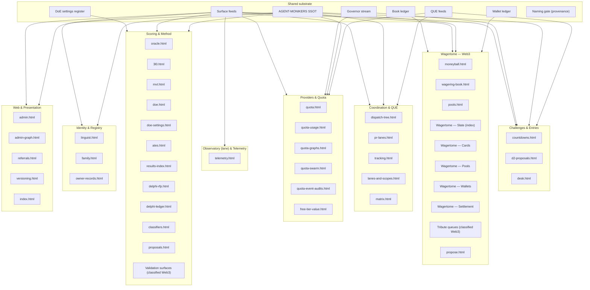

# Surfaces map — groups × taxonomy × shared substrate (docs version)

[MUSEai]@{role:{viz-dispatch-tree}} · DRAFT for review · generated from the SAME map data block as `apps/tribute-dashboard/surfaces-map.html` (PR #4888) — the two outputs cannot drift; corrections land in the data block and regenerate both.

Commission: owner via main 2026-11-04 (+ amendment: repos ∧ code layers per surface; sits inside the collision 💥 marketing recon program). Levels per reconciliation #4884. MoneyBall surfaces per DESIGN §12.

## Diagram (mermaid — Linguist .mmd rendering hand)

## Brand family

- **Wagertome** = the record · **WagerDome** = the venue/arena mark — HELD (no arena surfaces of record yet) · **booktally** = the unit (Registry PR #4825) · **Actuary** = the actor.
- Naming gate = PROVENANCE over the whole map (Registry reviewer of record), not a per-surface draw.

## Surfaces

Basis: all 37 tribute .html at master + MoneyBall section 12 set + propose.html = 43 surfaces + 2 classified classes (45 rows; classes counted as classes). admin.html is dual-home: Pages scaffold (inert) + gated admin-desk project (operative).

Levels per #4884 section C, sparse by the keying rule (a surface renders L iff its primary content IS an occupant of L or a direct projection). The topical axis is surface GROUPS - "plane" is a record word whose only referent is Pool.

| surface | home | group | levels rendered | draws from substrate | repo | code layers | release layer |
|---|---|---|---|---|---|---|---|
| quota.html | tribute | Providers & Quota | ∅ | Surface feeds · Governor stream · AGENT-MONIKERS SSOT | termux-monorepo | page · quota feeds · governor emitter · tests | quota pack stamps · governor readings carry their own as-of · site deploy |
| quota-usage.html | tribute | Providers & Quota | ∅ | Surface feeds · Governor stream | termux-monorepo | page · usage feed (lane-events) · tests | series snapshots append-only · site deploy |
| quota-graphs.html | tribute | Providers & Quota | ∅ | Surface feeds · Governor stream | termux-monorepo | page · series feeds (jsonl) · tests | series snapshots append-only · site deploy |
| quota-swarm.html | tribute | Providers & Quota | ∅ | Surface feeds · QUE feeds | termux-monorepo | page · QUE/swarm feeds · tests | site deploy (Pages per merge) · version-manifest stamp · ∅ per-surface release line |
| quota-event-audits.html | tribute | Providers & Quota | ∅ | Surface feeds | termux-monorepo | page · audits feed · tests | site deploy (Pages per merge) · version-manifest stamp · ∅ per-surface release line |
| admin.html | tribute Pages (inert scaffold) + admin-desk project (operative, gated) | Web & Presentation | ∅ | Surface feeds · AGENT-MONIKERS SSOT | termux-monorepo | page · status/admin feeds · systems inventory · tests | status.json gen stamps · P-phase decision log in-page · site deploy |
| admin-graph.html | tribute | Web & Presentation | ∅ | Surface feeds | termux-monorepo | page · admin feeds · tests | feed generated_at stamp + STALE chip · site deploy · ∅ release line |
| oracle.html | tribute | Scoring & Method | program | Surface feeds | termux-monorepo + delphi-oracle | page · oracle feed · upstream engine repo · tests | oracle feed stamps · engine-repo release line NOT_ESTABLISHED |
| 3l0.html | tribute | Scoring & Method | ∅ | Surface feeds | termux-monorepo | page · 3L0 session feeds · tests | feed generated_at stamp + STALE chip · site deploy · ∅ release line |
| moneyball.html | tribute | Wagertome — Web3 | ∅ | Surface feeds · Book ledger | termux-monorepo | page · moneyball feed · tests | feed generated_at stamp + STALE chip · site deploy · ∅ release line |
| wagering-book.html | tribute | Wagertome — Web3 | role | Book ledger · Surface feeds | termux-monorepo | page · feed+mirror · generator wagering_book_feed.py · book-feed/book/ledger sources · tests | feed generated_at + 48h STALE · feed/mirror/fixture byte-parity per refresh PR · site deploy · ∅ release line |
| pools.html | tribute | Wagertome — Web3 | plane · role | Wallet ledger | termux-monorepo ← moneyball | page · feed+mirror · upstream pools-feed (moneyball repo) · wallet-ledger source · tests | upstream feed stamps (ledger head seq) · mirror parity per refresh PR · site deploy · ∅ release line |
| mvt.html | tribute | Scoring & Method | ∅ | Surface feeds | termux-monorepo | page · MVT feed · tests | feed generated_at stamp + STALE chip · site deploy · ∅ release line |
| doe.html | tribute | Scoring & Method | office | Surface feeds · AGENT-MONIKERS SSOT | termux-monorepo | page · DoE feed · tests | feed generated_at stamp + STALE chip · site deploy · ∅ release line |
| doe-settings.html | tribute | Scoring & Method | ∅ | DoE settings register | termux-monorepo | page · settings register JSON + dashboard mirror · chartkit · contract tests | source register provenance · mirror byte-parity · stamped chart · site deploy |
| ates.html | tribute | Scoring & Method | ∅ | Surface feeds | termux-monorepo | page · ATES feed · tests | feed generated_at stamp + STALE chip · site deploy · ∅ release line |
| results-index.html | tribute | Scoring & Method | program | Surface feeds | termux-monorepo | page · results-index feed + canonical twin · builder · tests | feed generated_at + per-section STALE · site deploy |
| free-tier-value.html | tribute | Providers & Quota | ∅ | Surface feeds | termux-monorepo | page · free-tier feed · tests | feed generated_at stamp + STALE chip · site deploy · ∅ release line |
| dispatch-tree.html | tribute | Coordination & QUE | role | Surface feeds · QUE feeds · AGENT-MONIKERS SSOT | termux-monorepo | page · dispatch-tree feed · tests · scout module family: scripts/scout_roster.py + scout_missions.py + ci/tribute_scout.py + archwiz/correlation_scout.py + patch_success_scout.py + deepcli/investigator/capability_scout.py + scout tests x3 (PR #4893 F.1) | feed generated_at stamp + STALE chip · site deploy · ∅ release line |
| countdowns.html | tribute | Challenges & Entries | ∅ | Surface feeds | termux-monorepo | page · countdown data (register) · tests | register of record (deadline-reminders) · wall stamps · site deploy |
| d2-proposals.html | tribute | Challenges & Entries | ∅ | Surface feeds | termux-monorepo | page (static content of record) · tests | static of record · ∅ feed · site deploy |
| linguist.html | tribute | Identity & Registry | ∅ | Surface feeds · AGENT-MONIKERS SSOT | termux-monorepo | page · linguist feed · tests | feed generated_at stamp + STALE chip · site deploy · ∅ release line |
| delphi-rfp.html | tribute | Scoring & Method | program | Surface feeds | termux-monorepo | page · RFP feed · tests | feed generated_at stamp + STALE chip · site deploy · ∅ release line |
| delphi-ledger.html | tribute | Scoring & Method | program | Surface feeds | termux-monorepo | page · delphi ledger feed · tests | feed generated_at stamp + STALE chip · site deploy · ∅ release line |
| classifiers.html | tribute | Scoring & Method | ∅ | Surface feeds · AGENT-MONIKERS SSOT | termux-monorepo | page · classifier feeds · tests | feed generated_at stamp + STALE chip · site deploy · ∅ release line |
| pr-lanes.html | tribute | Coordination & QUE | role | Surface feeds · QUE feeds | termux-monorepo | page · pr-lanes feed + series · tests | feed generated_at stamp + STALE chip · site deploy · ∅ release line |
| proposals.html | tribute | Scoring & Method | program | Surface feeds | termux-monorepo | page · proposals feed · tests | feed generated_at stamp + STALE chip · site deploy · ∅ release line |
| referrals.html | tribute | Web & Presentation | domain | Surface feeds | termux-monorepo | page · referrals feed · tests | feed generated_at stamp + STALE chip · site deploy · ∅ release line |
| telemetry.html | tribute | Observatory (lane) & Telemetry | ∅ | Surface feeds | termux-monorepo | page · telemetry feed + history series · series generator · tests | feed generated_at + history-series appends · site deploy |
| desk.html | tribute | Challenges & Entries | role | Surface feeds · QUE feeds · AGENT-MONIKERS SSOT · Governor stream | termux-monorepo | page · desk-feed · coordinator source · QUE feeds · tests · scout module family: scripts/scout_roster.py + scout_missions.py + ci/tribute_scout.py + archwiz/correlation_scout.py + patch_success_scout.py + deepcli/investigator/capability_scout.py + scout tests x3 (PR #4893 F.1) | feed generated_at (bump-on-content-refresh rule) · site deploy |
| tracking.html | tribute | Coordination & QUE | ∅ | Surface feeds | termux-monorepo | page · tracking feed · deadline register source · tests | feed generated_at stamp + STALE chip · site deploy · ∅ release line |
| family.html | tribute | Identity & Registry | role | AGENT-MONIKERS SSOT · Surface feeds | termux-monorepo | page · family feed · monikers source · tests · scout module family: scripts/scout_roster.py + scout_missions.py + ci/tribute_scout.py + archwiz/correlation_scout.py + patch_success_scout.py + deepcli/investigator/capability_scout.py + scout tests x3 (PR #4893 F.1) | feed generated_at stamp + STALE chip · site deploy · ∅ release line |
| Wagertome — Slate (index) | moneyball repo | Wagertome — Web3 | ∅ | Wallet ledger · Book ledger | moneyball | site pages · site feeds · ledgers by reference | moneyball Pages deploy per merge · feed stamps · ∅ tagged releases (NOT_ESTABLISHED) |
| Wagertome — Cards | moneyball repo | Wagertome — Web3 | role | Wallet ledger · AGENT-MONIKERS SSOT | moneyball | site pages · cards-feed · WALLETS source (monorepo) | moneyball Pages deploy · cards-feed stamps · ∅ tagged releases (NOT_ESTABLISHED) |
| Wagertome — Pools | moneyball repo | Wagertome — Web3 | plane · role | Wallet ledger | moneyball | site pages · pools-feed · wallet-ledger source (monorepo) | moneyball Pages deploy · pools-feed census stamps (ledger head seq) · ∅ tagged releases (NOT_ESTABLISHED) |
| Wagertome — Wallets | moneyball repo | Wagertome — Web3 | role | Wallet ledger | moneyball | site pages · wallet views · wallet-ledger source (monorepo) | moneyball Pages deploy · ledger head seq stamps · ∅ tagged releases (NOT_ESTABLISHED) |
| Wagertome — Settlement | moneyball repo | Wagertome — Web3 | ∅ | Book ledger · Wallet ledger | moneyball | site pages · settlement views · replay.py · book+wallet ledgers | moneyball Pages deploy · replay reports @main · settlement stamps in-book · ∅ tagged releases (NOT_ESTABLISHED) |
| Tribute queues (classified Web3) | tribute | Wagertome — Web3 | ∅ | Surface feeds | termux-monorepo | queue surfaces · tribute gate config · status ledger · gate tests | gate config of record · status-ledger backfill stamps · lane PAUSED (∅ deploys by ruling) |
| Validation surfaces (classified Web3) | tribute | Scoring & Method | ∅ | Surface feeds | termux-monorepo | gate/status surfaces · validation tests | gate test suite of record · ∅ release line |
| propose.html | moneyball repo | Wagertome — Web3 | role | Surface feeds · Book ledger | moneyball | site page · proposals feed + receipt chain · S13 machinery (S13.3A) | moneyball Pages deploy · proposal-chain stamps (LISTED transitions in-book) |
| lanes-and-scopes.html | tribute | Coordination & QUE | role | Surface feeds · AGENT-MONIKERS SSOT | termux-monorepo | page · lanes feed · tests | site deploy (Pages per merge) · version-manifest stamp · no per-surface release line |
| matrix.html | tribute | Coordination & QUE | ∅ | Surface feeds | termux-monorepo | page · matrix feed · tests | site deploy (Pages per merge) · version-manifest stamp · no per-surface release line |
| owner-records.html | tribute | Identity & Registry | ∅ | Surface feeds | termux-monorepo | page · records feed · tests | site deploy (Pages per merge) · version-manifest stamp · no per-surface release line |
| versioning.html | tribute | Web & Presentation | ∅ | Surface feeds | termux-monorepo | page · version-manifest source · versioning.js · tests | site deploy (Pages per merge) · the version-stamp surface itself |
| index.html | tribute | Web & Presentation | ∅ | Surface feeds | termux-monorepo | shell page · status payload · tests | site deploy (Pages per merge) · the deployment front door |
## Reserved names

- **bookmaker** · **11th man** — RESERVED · ABSENT (held, never rendered live).
- **Coach** — RESERVED · UNGROUNDED (asserted, no basis). Absent is not ungrounded.

## Shared substrate

| element | what it is | consumers (count) |
|---|---|---|
| AGENT-MONIKERS SSOT | canonical names · collapse registry · moniker graduations | 10 |
| Surface feeds | per-surface data/*.json under DASHBOARD-SURFACE-FEEDS contracts | 38 |
| DoE settings register | ops/doe/settings-register.json — versioned method/settings projection with source provenance | 1 |
| QUE feeds | measurement · governor · queue-by-tier · priority windows | 4 |
| Wallet ledger | ops/agentic-gambling/site/wallet-ledger.jsonl — pools · wallets · folds | 6 |
| Book ledger | ops/agentic-gambling/book/ ledger.jsonl + challenges-book — subjects · positions · settlements | 5 |
| Governor stream | PAT flow governor {used · remaining · projected · trigger · hard limit} | 4 |
| Naming gate (provenance) | PROVENANCE over the whole map — Registry reviewer of record · #4884 reconciliation · gate rulings; not a per-surface draw | 0 |

## Release lines of record (repo level)

- termux-monorepo: submission-freeze-2026-11-04 tag (D1 freeze of record) · ss surface releases v0.1.0→v1.0.0 ride the studysprint repo, not these surfaces · tribute site = one Pages deployment per merge (build stamp = deploy run).
- moneyball: ∅ tagged releases established — Pages deploys + feed/ledger stamps carry the version story (NOT_ESTABLISHED beyond that).
- Artifacts riding release lines: APK assets on ss releases · feed fixtures pinned per refresh PR · replay reports @main (moneyball).

## Reading notes

- Observatory/ForeSight = LANE of record; program/method readings secondary, never class assignments.

- Dual-home surfaces draw once, at their group: the Book renders on tribute from the book ledger; Cards/Pools/Wallets/Settlement serve from the MoneyBall site on the same ledgers.
- Pools appears on both homes over one wallet ledger — one fold, two renders.
- Levels name what a surface RENDERS, not what it is.
- desk.html is the widest consumer: desk-feed + QUE feeds + governor stream + monikers.
