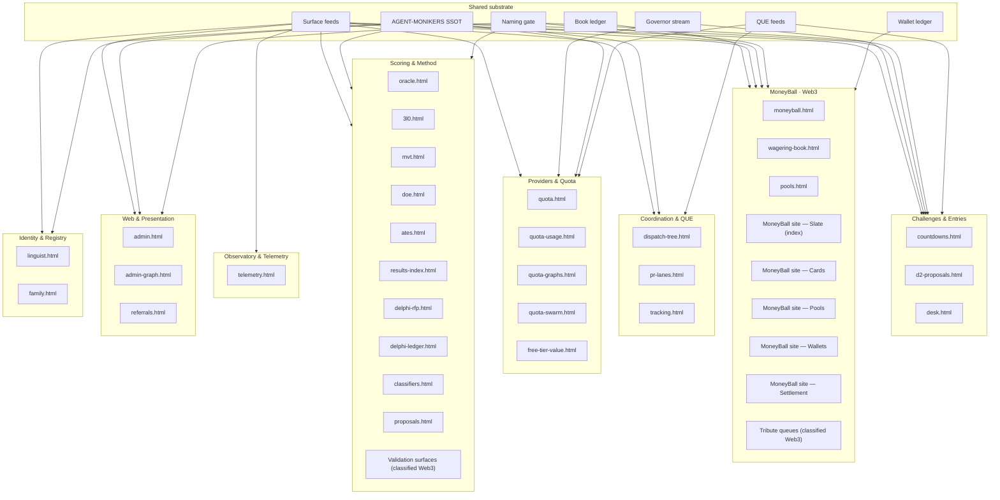

# Surfaces map — planes × taxonomy × shared substrate (docs version)

[MUSEai]@{role:{viz-dispatch-tree}} · DRAFT for review · generated from the SAME map data block as `apps/tribute-dashboard/surfaces-map.html` (PR #4888) — the two outputs cannot drift; corrections land in the data block and regenerate both.

Commission: owner via main 2026-11-04 (+ amendment: repos ∧ code layers per surface; sits inside the collision 💥 marketing recon program). Levels per reconciliation #4884. MoneyBall surfaces per DESIGN §12.

## Diagram (mermaid — Linguist .mmd rendering hand)

## Surfaces

| surface | home | plane | levels rendered | draws from substrate | repo | code layers |
|---|---|---|---|---|---|---|
| quota.html | tribute | Providers & Quota | domain · structure | Surface feeds · Governor stream · AGENT-MONIKERS SSOT | termux-monorepo | page · quota feeds · governor emitter · tests |
| quota-usage.html | tribute | Providers & Quota | domain · structure | Surface feeds · Governor stream | termux-monorepo | page · usage feed (lane-events) · tests |
| quota-graphs.html | tribute | Providers & Quota | domain · method | Surface feeds · Governor stream | termux-monorepo | page · series feeds (jsonl) · tests |
| quota-swarm.html | tribute | Providers & Quota | plane · structure | Surface feeds · QUE feeds | termux-monorepo | page · QUE/swarm feeds · tests |
| admin.html | tribute | Web & Presentation | structure · office | Surface feeds · AGENT-MONIKERS SSOT · Naming gate | termux-monorepo | page · status/admin feeds · systems inventory · tests |
| admin-graph.html | tribute | Web & Presentation | structure | Surface feeds | termux-monorepo | page · admin feeds · tests |
| oracle.html | tribute | Scoring & Method | method · program | Surface feeds | termux-monorepo + delphi-oracle | page · oracle feed · upstream engine repo · tests |
| 3l0.html | tribute | Scoring & Method | method | Surface feeds | termux-monorepo | page · 3L0 session feeds · tests |
| moneyball.html | tribute | MoneyBall · Web3 | program · plane | Surface feeds · Book ledger | termux-monorepo | page · moneyball feed · tests |
| wagering-book.html | tribute | MoneyBall · Web3 | program · structure | Book ledger · Surface feeds | termux-monorepo | page · feed+mirror · generator wagering_book_feed.py · book-feed/book/ledger sources · tests |
| pools.html | tribute | MoneyBall · Web3 | structure · plane | Wallet ledger · Naming gate | termux-monorepo ← moneyball | page · feed+mirror · upstream pools-feed (moneyball repo) · wallet-ledger source · tests |
| mvt.html | tribute | Scoring & Method | method | Surface feeds | termux-monorepo | page · MVT feed · tests |
| doe.html | tribute | Scoring & Method | method · office | Surface feeds · AGENT-MONIKERS SSOT | termux-monorepo | page · DoE feed · tests |
| ates.html | tribute | Scoring & Method | method | Surface feeds | termux-monorepo | page · ATES feed · tests |
| results-index.html | tribute | Scoring & Method | method · program | Surface feeds | termux-monorepo | page · results-index feed + canonical twin · builder · tests |
| free-tier-value.html | tribute | Providers & Quota | domain | Surface feeds | termux-monorepo | page · free-tier feed · tests |
| dispatch-tree.html | tribute | Coordination & QUE | structure · office · role | Surface feeds · QUE feeds · AGENT-MONIKERS SSOT | termux-monorepo | page · dispatch-tree feed · tests |
| countdowns.html | tribute | Challenges & Entries | program · structure | Surface feeds | termux-monorepo | page · countdown data (register) · tests |
| d2-proposals.html | tribute | Challenges & Entries | program | Naming gate | termux-monorepo | page (static content of record) · tests |
| linguist.html | tribute | Identity & Registry | structure · domain | Surface feeds · AGENT-MONIKERS SSOT | termux-monorepo | page · linguist feed · tests |
| delphi-rfp.html | tribute | Scoring & Method | method · program | Surface feeds | termux-monorepo | page · RFP feed · tests |
| delphi-ledger.html | tribute | Scoring & Method | program · structure | Surface feeds | termux-monorepo | page · delphi ledger feed · tests |
| classifiers.html | tribute | Scoring & Method | method · structure | Surface feeds · AGENT-MONIKERS SSOT | termux-monorepo | page · classifier feeds · tests |
| pr-lanes.html | tribute | Coordination & QUE | structure · role | Surface feeds · QUE feeds | termux-monorepo | page · pr-lanes feed + series · tests |
| proposals.html | tribute | Scoring & Method | method · program | Surface feeds | termux-monorepo | page · proposals feed · tests |
| referrals.html | tribute | Web & Presentation | program · domain | Surface feeds | termux-monorepo | page · referrals feed · tests |
| telemetry.html | tribute | Observatory & Telemetry | plane · structure | Surface feeds | termux-monorepo | page · telemetry feed + history series · series generator · tests |
| desk.html | tribute | Challenges & Entries | office · program · role | Surface feeds · QUE feeds · AGENT-MONIKERS SSOT · Governor stream | termux-monorepo | page · desk-feed · coordinator source · QUE feeds · tests |
| tracking.html | tribute | Coordination & QUE | program · structure | Surface feeds | termux-monorepo | page · tracking feed · deadline register source · tests |
| family.html | tribute | Identity & Registry | role · structure | AGENT-MONIKERS SSOT · Surface feeds | termux-monorepo | page · family feed · monikers source · tests |
| MoneyBall site — Slate (index) | moneyball repo | MoneyBall · Web3 | program | Wallet ledger · Book ledger · Naming gate | moneyball | site pages · site feeds · ledgers by reference |
| MoneyBall site — Cards | moneyball repo | MoneyBall · Web3 | structure · role | Wallet ledger · AGENT-MONIKERS SSOT | moneyball | site pages · cards-feed · WALLETS source (monorepo) |
| MoneyBall site — Pools | moneyball repo | MoneyBall · Web3 | structure · plane | Wallet ledger | moneyball | site pages · pools-feed · wallet-ledger source (monorepo) |
| MoneyBall site — Wallets | moneyball repo | MoneyBall · Web3 | structure | Wallet ledger | moneyball | site pages · wallet views · wallet-ledger source (monorepo) |
| MoneyBall site — Settlement | moneyball repo | MoneyBall · Web3 | program · structure | Book ledger · Wallet ledger | moneyball | site pages · settlement views · replay.py · book+wallet ledgers |
| Tribute queues (classified Web3) | tribute | MoneyBall · Web3 | structure | Surface feeds · Naming gate | termux-monorepo | queue surfaces · tribute gate config · status ledger · gate tests |
| Validation surfaces (classified Web3) | tribute | Scoring & Method | method · structure | Surface feeds · Naming gate | termux-monorepo | gate/status surfaces · validation tests |

## Shared substrate

| element | what it is | consumers (count) |
|---|---|---|
| AGENT-MONIKERS SSOT | canonical names · collapse registry · moniker graduations | 9 |
| Surface feeds | per-surface data/*.json under DASHBOARD-SURFACE-FEEDS contracts | 30 |
| QUE feeds | measurement · governor · queue-by-tier · priority windows | 4 |
| Wallet ledger | ops/agentic-gambling/site/wallet-ledger.jsonl — pools · wallets · folds | 6 |
| Book ledger | ops/agentic-gambling/book/ ledger.jsonl + challenges-book — subjects · positions · settlements | 4 |
| Governor stream | PAT flow governor {used · remaining · projected · trigger · hard limit} | 4 |
| Naming gate | Registry reviewer of record · #4884 reconciliation · gate rulings | 6 |

## Reading notes

- Dual-home surfaces draw once, at their plane: the Book renders on tribute from the book ledger; Cards/Pools/Wallets/Settlement serve from the MoneyBall site on the same ledgers.
- Pools appears on both homes over one wallet ledger — one fold, two renders.
- Levels name what a surface RENDERS, not what it is.
- desk.html is the widest consumer: desk-feed + QUE feeds + governor stream + monikers.
