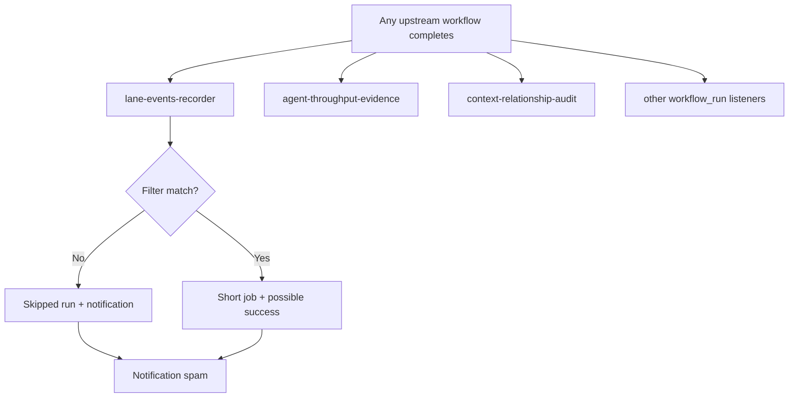

# Actions Workflows Consolidated Matrix & Cadence Upgrade

**Branch:** `ops/actions-matrix-upgrade-2026-10-18`  
**Generated:** 2026-10-26  
**Status:** Living document — diagnostic + refinement pass. Zero Failures target remains aspirational; residual skipped/cancelled cascades and 214+ active workflows drive notification volume.

## Executive Summary

- **Total workflows registered:** ~214 active.
- **Recent master runs (2026-10-26 window):** Predominantly `success` or intentional `skipped` (concurrency / path filters / observer budget). No terminal `failure` observed in the latest completed batch on tip SHA `58959594daeac1bdab62dd953343fd8efb3a54db`.
- **Spam sources:** High-volume `workflow_run` listeners (`lane-events-recorder`, `agent-throughput-evidence`, `context-relationship-audit`, etc.) fire on nearly every upstream completion, producing cascades of skipped or short-lived runs that still generate notifications.
- **Quota / capacity:** Quota Dispatch Tree and related observers succeed; residual rate-limit / 403 classes are deferred or historical. Adaptive caching and memoization already present in recent commits (provider registry).
- **Pinggy / device identity:** Required operational on device #1 (original BLU B160V#1). Public obfuscation of device identification data must be preserved. Alternatives (Tailscale, etc.) are redundant fallbacks, not replacements. September tests targeted original device; replication on #2 is separate.
- **Historical silenced failures:** Many earlier failures (zero-job filename, catalog race, jq argmax, DNS preflight, Dependabot unresolvable, ghost queued runs on disabled workflows) have been repaired or classified as historical / superseded. Ghost run 37655538554 remains queued on disabled workflow id 354842048 — cancel/delete blocked by permissions; does not serialize current v3 queue.
- **Feature preservation:** Dual-gate (hygiene + portability + agentic termux smoke) remains promote authority. Vercel rate-limit is non-gate. Advisory reviewers (CodeRabbit, Devin, Copilot) do not block.

## Repeated Issue Classes (Consolidated)

| Class | Symptom | Root Cause | Status / Fix | Notes / Superseded |
|-------|---------|------------|--------------|--------------------|
| Zero-job / filename | Workflow listed but 0 jobs, conclusion failure | Placeholder YAML, bad path, or concurrency cancel before start | Historical; reaper + careful commits | Closed on multiple SHAs |
| Catalog race / drift | `--check` failure after receipt | Concurrent catalog refresh | Deferred / fixed on repair branches | Historical Evaluation Correlation |
| jq argmax / pipefail | Exit 126/1, broken pipe | Unbounded argv or pipefail under load | Fixed (bounded, materialize) | Ledger, queue inventory |
| DNS / host resolution | Exit 255 SSH name resolution | Transient environment | Preflight added | continuous-improve |
| Dependabot unresolvable | security_update_not_possible | npm group conflicts | Ignore list applied | Historical on specific SHA |
| Ghost queued | status=queued, 0 jobs forever | Disabled workflow residual | Permissions block delete | Does not block v3 |
| High-volume skipped | Many skipped workflow_run | Broad triggers + concurrency | Needs modular consolidation | Residual spam |
| Quota / 403 / 429 | Deferred or exit 2 | Rate limits | Adaptive retry + defer | Not compile failures |
| Pinggy / tunnel | Device connectivity | Device #1 screen broken; #2 separate | Must remain operational with opaque ID | Alternatives redundant |

## Cadence & Notification Reduction Plan

1. **Modularize high-fanout listeners:** Convert broad `workflow_run` on *all* workflows into targeted lists or a single consolidated "lane events" observer with internal filtering. Prefer `workflow_call` or explicit `types` + path filters.
2. **Concurrency groups:** Strengthen `concurrency` with `cancel-in-progress: true` only where safe; otherwise use `group` + skip-if-recent logic inside the job to avoid notification-generating skipped runs.
3. **Observer budget:** Extend the 21-day / stale-observer-budget pattern from Merge Promotion Queue v3 to other high-frequency auditors.
4. **Cache & telemetry (3L0 moneyball):** Continue memoization of provider registries, evidence matching, and adaptive wait. Emit structured receipts instead of raw notifications for quiet periods.
5. **Disabled / superseded workflows:** Archive or disable unused ones (e.g. temporary catalog refresh, old steward regenerates) after confirming no downstream callers. Document in this matrix.
6. **Quota planning:** Keep Quota Dispatch Tree and provider managers as the single observation plane. No new pollers.

## Device & Tunnel Requirements

- **Device #1 (original BLU B160V):** Pinggy (or equivalent) **must** be operational. Public device identification data must be obfuscated (opaque ID such as `tmx-node-primary` or similar).
- **Device #2:** Separate replication target; do not assume shared state.
- **Alternatives:** Tailscale, ngrok, etc. are acceptable redundant fallbacks but do not replace the Pinggy requirement for #1.
- **Evidence:** Tunnel Canary workflows should emit opaque device_id and lag classification without leaking private identifiers.

## Flowchart: Current High-Fanout Pattern (to be refined)

**Target:** Single consolidated observer or tighter trigger lists + internal early-exit that does not create a run record, or batching.

## Superseded / Combined Workflows

- Multiple temporary catalog refresh / steward regenerate workflows: candidates for archival.
- Operations Cadence Audit (old id) previously absent; ensure single source.
- Merge Promotion Queue evolved v1 → v2 → v3; old ids disabled. Ghost residual noted.
- Agent Jules / review / handoff family: review for overlap; consolidate where features preserved.

## Next Actions

- [ ] Audit and disable/archive low-value or fully superseded workflows after confirming no callers.
- [ ] Tighten `workflow_run` `workflows:` lists or introduce a central dispatcher.
- [ ] Add early-exit guards that avoid run creation where possible (or accept skipped but suppress notifications via rules if available).
- [ ] Re-confirm Pinggy operational on device #1 with opaque ID evidence.
- [ ] Refresh this matrix on each major cadence change.
- [ ] Continue dual-gate monitoring; promote only on current-SHA evidence.

## References

- Dual-gate: hygiene + portability + agentic termux smoke.
- Adaptive-wait and evidence-led skills.
- Issue #184 (credentials surface — names-only).
- Quota registry and provider managers under `ops/quota/` and `docs/ops/`.

---
*This document is the consolidated matrix. Feature preservation is mandatory; refinements must not regress dual-gate or tunnel requirements.*
