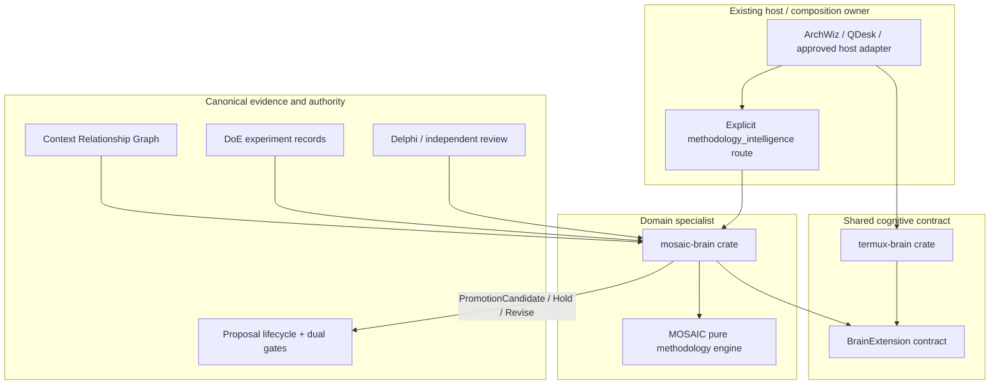

# MOSAIC Brain ↔ Root Brain Integration — High-Detail Architecture Proposal

**Proposal ID:** MOS-007  
**Parent:** Continuous Capability Evolution Laboratory (CEEL) / DoE family  
**Related work:** MOS-001–MOS-006; root Brain PR #5492; MOSAIC documentation PR #5502; qdesk.brain-rs RFP #5501  
**Status:** implementation in progress; typed contract and pure specialist crate are included in PR #5525; no host runtime integration claimed  
**Revision:** 0.1.0 · 2026-11-16  
**Decision owner:** repository operator through existing proposal lifecycle  
**Implementation target:** a one-way, versioned extension contract with composition outside the root kernel

---

## 1. Executive decision

**Keep MOSAIC in `archwiz/mosaic_brain/`. Do not relocate its implementation into `brain/`, do not put it inside the Context Relationship Graph Rust accelerator, and do not make root Brain depend directly on the MOSAIC crate.**

Connect it through a small, domain-neutral extension contract exported by the existing `termux-brain` crate. MOSAIC depends on that contract and implements it. The existing host/orchestration surface that owns the call site composes the two packages and routes a methodology-intelligence request to MOSAIC. The root kernel remains provider-neutral and domain-neutral.

This is a **dependency pointer**, not a source-file pointer:

- MOSAIC's Cargo package depends on the root Brain facade by a local Cargo path dependency.
- The host/composition owner depends on both `termux-brain` and `mosaic-brain`.
- The root Brain package does not depend on `mosaic-brain`.
- No `#[path]` inclusion, symlink, Git submodule, copied source, or second root kernel is needed.
- The actual host crate and serialization bridge remain an explicit recon item until their current owner contract is verified.

The existing MOSAIC design's location is retained. The root Brain's current seven reasoning stages are retained. MOSAIC is an optional specialist extension, not an eighth mandatory reasoning stage and not a new orchestration plane.

### Decision table

| Question | Decision | Reason |
|---|---|---|
| Relocate MOSAIC into `brain/`? | **No** | It is a DoE/CEEL-owned methodology specialist, not generic kernel logic. |
| Keep a pointer to MOSAIC from root Brain? | **Yes, via a typed contract and host composition** | A stable contract avoids source coupling and circular dependencies. |
| Root Brain Cargo-depends on MOSAIC? | **No** | It inverts ownership and makes the shared kernel depend on one domain. |
| MOSAIC Cargo-depends on root Brain? | **Yes** | The specialist implements the shared extension contract. |
| Add a new root capability registry? | **No** | Reuse the existing capability/integration registries and host's static wiring. |
| Add a new queue, ledger, scheduler or graph? | **No** | Existing QUE, DoE, CRG, proposal, evidence and FA-ADE owners remain canonical. |
| Run MOSAIC automatically on every Brain request? | **No** | Route only explicit methodology-intelligence tasks; preserve cost and scope bounds. |
| Is runtime connection complete now? | **No** | The two PRs currently describe separate lines; the contract and host wiring are not yet implemented or validated. |

---

## 2. Recon findings: verified facts and open points

### 2.1 Verified repository facts

1. Root Brain PR [#5492](https://github.com/timerloggedout-spec/termux-monorepo/pull/5492) is an open feature branch based on `master`, with head `8c6e5526d4f523fdb7ff9459049df528f80b228b` at the inspected snapshot.
2. That branch contains root `brain.rs`, the standalone `brain/` Cargo facade, a README, tests and a Rust workflow. `brain/src/lib.rs` currently imports the root source with `#[path = "../../brain.rs"]` and re-exports it. The facade is intentionally not a root Cargo workspace.
3. The kernel defines seven stages: Intent, Decomposition, Strategy, ExecutionDesign, Validation, Optimization and Reflection. It has injected `StageBackend` and `PolicyGate` interfaces. It reasons and returns typed plans/decisions; it does not execute tools, persist memory, own policy or call a provider itself.
4. The current root `brain.rs` is a single large source module. The 21 subsystem families in the subsystem map are a target taxonomy, not proof that 21 Rust modules or adapters already exist.
5. The root Brain ownership map explicitly assigns canonical authority to existing owners including ICM, CRG, QUE, dispatch/claim, hub_mcp policy, provider routing, memory, evidence, Delphi/DoE, adaptive-wait, SHE and owner-facing projections. It prohibits replacement queues, schedulers, registries, memory stores, relationship graphs and evidence ledgers.
6. MOSAIC PR [#5502](https://github.com/timerloggedout-spec/termux-monorepo/pull/5502) is a separate open documentation branch based on `master`. Its head at the inspected snapshot is `c68566462bfa786f4679c0bcc47e0b9a0dc907d0`.
7. MOSAIC's existing RFP and design specify `archwiz/mosaic_brain/`, crate `mosaic-brain`, source `archwiz/mosaic_brain/src/brain.rs`, domain `methodology_intelligence`, CRG scope ID `mosaic-brain`, and advisory-only output.
8. MOSAIC's existing plan explicitly keeps its Rust core pure, deterministic and free of network/filesystem side effects. It consumes references to canonical DoE records and metadata-only CRG relationships. The CRG Python compiler remains authoritative; its Rust accelerator is limited to fragment fingerprinting and pointer-cost analysis.
9. MOSAIC's recommendation vocabulary is `PromotionCandidate`, `Hold` and `Revise`. `Cull`, state transitions, merge and promotion remain outside MOSAIC.
10. The CEEL `ITEMS.md` already contains MOS-001 through MOS-006. MOS-007 is the missing work item for root-kernel contract and composition integration.
11. The scope registry inspected on the root Brain branch did not yet contain a `mosaic-brain` scope. The MOSAIC plan requests adding it through the existing registry and publisher; generated graph artifacts must not be hand-edited.
12. The current Brain RFP #5501 describes QUE/QDesk integration as a request for evaluation and records that filing does not grant execution authority. Its admission result is not a technical integration test.

### 2.2 Not verified; must not be represented as fact

- Whether the current `master` contains either feature branch's complete changes.
- Whether PR #5492's current Rust workflow matrix has passed on its exact current head.
- A production-ready QDesk/QUE Rust host crate or a current versioned JSONL bridge contract.
- The final ownership of the Rust composition call site (ArchWiz, QDesk, another existing host, or a small separately admitted bridge).
- A live MOSAIC crate, extension trait, runtime registration, CRG scope publication, or working MOSAIC-to-Brain call.
- Whether any proposed adapter is operational on Termux or GitHub Actions.

The two feature branches must be reconciled against live master and one another before implementation. Do not merge either branch merely to make a path dependency resolve.

---

## 3. Architecture and dependency direction

### 3.1 Dependency graph



**Important:** the diagram describes the intended dependency and data flow, not current runtime wiring. The host is deliberately a placeholder for the existing owner that recon identifies. No new host crate is authorized by this proposal by default.

### 3.2 Contract location

Add the generic extension contract as a sibling module in the existing `brain/` crate facade:

- `brain/src/extensions.rs`
- export it from `brain/src/lib.rs`
- keep the existing `brain.rs` kernel source as the source of truth during the first integration slice
- do not extract all seven stages or create empty placeholder modules as part of MOS-007

The contract should be small and stable. It should contain only concepts that are genuinely shared by independent domain extensions:

- extension identifier and contract version;
- domain identifier;
- typed run/correlation identity using the existing Brain identity type;
- a domain-neutral request envelope or associated request type;
- an extension result envelope or associated response type;
- explicit status, recommendation summary, reason codes and evidence references;
- a descriptor for name, owner, version and supported domain.

Two viable shapes require a focused design choice during MOS-007 implementation:

**Preferred initial shape — compile-time typed extension**

```rust
pub trait BrainExtension {
    type Request;
    type Response;

    fn descriptor(&self) -> ExtensionDescriptor;

    fn evaluate(
        &self,
        request: &Self::Request,
    ) -> Result<Self::Response, ExtensionError>;
}
```

This keeps the core standard-library-only, avoids inventing a universal serialization format, and lets `mosaic-brain` return its native strongly typed `Recommendation`. The composition host owns the concrete request and response types.

**Alternative — object-safe envelope**

Use a domain-neutral `ExtensionRequest` / `ExtensionResponse` only if the existing host needs runtime-loaded heterogeneous extensions. This would require a serialization contract and compatibility policy. Do not introduce `serde`, dynamic loading or a plugin manager solely for MOSAIC. If the actual host is Python, verify its established JSONL schema before selecting this alternative.

### 3.3 MOSAIC implementation

The MOSAIC crate implements the shared trait and keeps its methodology domain types private to, or publicly namespaced under, `mosaic_brain`:

- `MethodIdentity`
- `EvidenceRef`
- `ReviewVerdict`
- `EvaluationSnapshot`
- `Recommendation`
- `ValidationError`
- `validate_identity`
- `recommend`

The implementation should not force MOSAIC's domain types into the root kernel. The host receives the typed response and renders or forwards it through existing proposal and review workflows.

### 3.4 Composition and registration

Do not create a second extension registry.

- Use the existing capability/integration inventory to describe the extension and its owner.
- Use static construction in the existing host if there is one configured specialist.
- If dynamic discovery is later required, extend the canonical capability registry through its owner and schema; do not create a Brain-only registry.
- A registration record is descriptive metadata, not proof that a callable adapter is integrated or operational.
- Route only requests explicitly classified as `methodology_intelligence`; do not broadcast every user task to MOSAIC.

### 3.5 Why not relocate or use a raw pointer?

| Option | Assessment |
|---|---|
| Move `archwiz/mosaic_brain/src/brain.rs` under `brain/src/` | Rejected: merges domain ownership into the generic kernel and makes the taxonomy misleading. |
| Use Rust `#[path]` from root Brain into MOSAIC | Rejected: source-level coupling, fragile relative paths, bypasses package boundaries and encourages a second compilation view. |
| Use a symlink | Rejected: weak cross-platform packaging and unclear ownership. |
| Add MOSAIC as a Git submodule | Rejected: same-repository source does not need a submodule; submodules are for reviewed external pinned dependencies. |
| Root kernel depends on `mosaic-brain` | Rejected: dependency inversion and domain lock-in. |
| MOSAIC depends on `termux-brain`; host depends on both | **Accepted**: acyclic dependency graph, clear ownership, testable contract. |
| JSONL bridge | Conditional: use only if the actual owning host is cross-language and a current schema is verified. |

---

## 4. Target directory organization

### 4.1 Near-term tree — MOS-007

```text
brain.rs                              # existing shared kernel source; compatibility retained
brain/
  Cargo.toml                          # existing termux-brain package
  README.md
  src/
    lib.rs                            # facade over brain.rs + extension contract
    extensions.rs                     # new domain-neutral extension contract
  tests/
    brain.rs                          # existing kernel contract tests
    extensions.rs                     # new extension contract tests

archwiz/
  mosaic_brain/
    Cargo.toml                        # new mosaic-brain package
    README.md                          # ownership, use, boundaries, validation
    src/
      lib.rs                           # public specialist API
      brain.rs                         # pure methodology recommendation engine
      identity.rs                      # method identity and immutable version validation
      evidence.rs                      # references to canonical evidence only
      recommendation.rs                # Hold / Revise / PromotionCandidate rules
      adapter.rs                       # implements termux-brain extension contract
    tests/
      brain_contract.rs                # identity, evidence, independence, recommendation tests

docs/
  proposals/active/continuous-capability-evolution-lab/
    ITEMS.md                           # MOS-007 work ledger
    MOSAIC-BRAIN-RFP.md
    MOSAIC-BRAIN-ROOT-INTEGRATION-PROPOSAL.md
  superpowers/
    specs/2026-11-16-mosaic-brain-design.md
    plans/2026-11-16-mosaic-brain-implementation.md
  icm/
    objects/operations/
      brain-kernel.md
      mosaic-brain.md                  # MOS-004 route card

config/
  context_relationships/
    scope_registry.json                # MOS-003; canonical scope declaration
```

The per-file split under `archwiz/mosaic_brain/src/` is a target organization, not a requirement to create empty files. MOS-001 may begin with fewer source files if the pure API is still small; split only when a module owns a real contract and tests.

### 4.2 Root Brain evolution tree — later, separate work packages

The shared kernel should evolve from the single source module into cohesive, contract-backed modules, without creating empty placeholders or duplicating owner systems:

```text
brain/
  src/
    lib.rs
    kernel.rs                         # orchestration of the seven reasoning stages
    contracts/
      identity.rs                     # run/cycle/attempt identity types
      evidence.rs                     # evidence reference and confidence vocabulary
      capability.rs                   # capability descriptor, not a registry
      policy.rs                       # injected policy boundary, not policy rules
    stages/
      intent.rs
      decomposition.rs
      strategy.rs
      execution_design.rs
      validation.rs
      optimization.rs
      reflection.rs
    context/
      selection.rs
      provenance.rs
      freshness.rs
      sensitivity.rs
    planning/
      dag.rs
      validation.rs
    extensions.rs                     # generic extension seam
    adapters/
      icm.rs                           # read-only ICM adapter, when contract verified
      crg.rs                           # read-only CRG adapter, when contract verified
      qdesk.rs                         # shadow handoff only, when owner contract verified
    tests/
      ...
brain.rs                              # compatibility re-export during migration
```

This is an incremental destination, not one large refactor. Keep the existing facade and all downstream consumers working while each extraction is independently tested. Do not create `brain/src/registry.rs` as a competing capability registry. Do not create generic adapters for owners whose APIs have not been inspected.

### 4.3 Directory placement rules

1. `brain/` contains generic cognition contracts and shared kernel behavior only.
2. `archwiz/mosaic_brain/` contains methodology-specific models and recommendation logic.
3. `archwiz/context_relationships/` remains the canonical graph builder/query/temporal owner; MOSAIC only consumes graph references.
4. `docs/proposals/active/continuous-capability-evolution-lab/` owns MOSAIC program scope, RFP, work ledger and integration proposal.
5. `docs/icm/objects/operations/` owns navigation cards, not implementation.
6. `.github/workflows/` owns focused CI, with least privilege and path filters.
7. Generated CRG indexes are produced only by the existing publisher.
8. Do not add a root Cargo workspace solely for MOSAIC. Add one only if a separate repository-wide Rust packaging decision is justified and evaluated across all consumers.

---

## 5. Root Brain subsystem integration map

The 21 families in the subsystem taxonomy remain the full cognitive architecture. They should not all become Rust modules at once. Each is an integration boundary mapped to its canonical owner.

| # | Family | Proposed Rust boundary | Integration posture | Initial priority |
|---:|---|---|---|---|
| 00 | Identity & intent | `contracts/identity.rs`, `stages/intent.rs` | Consume canonical intake identity; preserve actor/scope provenance | P0 |
| 01 | Perception & ingestion | `adapters/` observation envelopes | Normalize source observations; source systems retain event ownership | P2 |
| 02 | Context assembly | `context/` | Read ICM/CRG and existing context cache; freshness/sensitivity/budget tests | P1 |
| 03 | Knowledge & memory | `adapters/icm.rs`, `adapters/crg.rs` | Retrieval/read-only first; memory owner retains persistence | P1 |
| 04 | Repository ontology | `ontology/` only when justified | Query ICM/CRG/capability metadata; no second graph | P2 |
| 05 | Research intelligence | `research/` | Evidence dossier adapter; cite and qualify sources | P2 |
| 06 | Capability discovery | `contracts/capability.rs` | Project existing catalog records; no new registry or routing authority | P1 |
| 07 | Reasoning & synthesis | `kernel.rs`, `stages/` | Existing seven typed stages | P0 |
| 08 | Decomposition & planning | `planning/` | Existing DAG validation and plan types; no scheduler | P0 |
| 09 | Simulation & prediction | `simulation/` adapter | Reuse DoE/ForeSight/decision engines; never fabricate forecasts | P2 |
| 10 | Policy, safety & authority | `contracts/policy.rs` | Inject existing hub_mcp/owner policy; fail closed | P0 |
| 11 | Orchestration coordination | `adapters/qdesk.rs` or host seam | Shadow handoff; QUE owns admission and lifecycle | P1 |
| 12 | Execution interface | No executor in kernel | Existing Harness/Hands/Actions execute; Brain requests handoff only | P2 |
| 13 | Verification & evidence | `contracts/evidence.rs` | Link authoritative receipts and validators; distinguish task from workflow success | P1 |
| 14 | Observability & explainability | trace projection | Reuse receipts/telemetry; no new telemetry ledger | P2 |
| 15 | Adaptation & learning | learning-candidate contract | Reuse Delphi/DoE/memory owner; no self-promotion | P2 |
| 16 | Resilience & resources | degraded-state contract | Reuse adaptive-wait, SHE, quota and recovery owners | P2 |
| 17 | Security & adversarial defense | security signal adapter | Reuse security/sandbox/policy owners; no new authority | P0 |
| 18 | Multi-agent / swarm cognition | swarm adapter | Reuse admission, participant identity and Delphi | P3 |
| 19 | Domain cognition | `extensions.rs` contract; MOSAIC is first specialist | Host composes domain packages; no monolithic root dependency | P1 |
| 20 | Owner experience | projection contract | ArchWiz/QDesk/Termux show state; do not own it | P3 |

**Priority meanings:** P0 = kernel contract/safety prerequisites; P1 = minimum useful read-only or shadow integration; P2 = evidence-backed follow-on; P3 = later specialization after prerequisites. Priority is sequencing, not a claim of implementation status.

### 5.1 MOSAIC's exact responsibility within the map

MOSAIC implements only a slice of family 19 (Domain cognition), with a specialist focus on methodology evaluation. It may consume family 02/03/13/15 inputs through references and host-provided snapshots. It does not own those families.

### 5.2 QDesk is not another Brain

QDesk/QUE remains the intake, admission, queue, claim and orchestration owner. It can host or invoke the root Brain and route an explicitly classified domain request to MOSAIC. QDesk must not fork the root reasoning kernel. MOSAIC must not claim, queue, dispatch, execute, verify or promote.

---

## 6. Shared contract definitions

### 6.1 Extension descriptor

A descriptor should include:

- `extension_id`: stable reverse-domain or repository-scoped identifier, e.g. `org.termux.mosaic.methodology`;
- `contract_version`: semver or the existing repository contract-version convention;
- `display_name`;
- `owner`: canonical owning project/team;
- `domain_id`: `methodology_intelligence`;
- `capability_ids`: references to existing capability IDs, not new local IDs unless admitted by the canonical registry;
- `status`: proposed maturity state, not an assertion of operational readiness.

### 6.2 Extension request

The host supplies:
- the existing `RunIdentity` (orchestration, cycle, attempt);
- an explicit domain and requested operation;
- immutable method identity and the evidence-reference set required by MOSAIC;
- source freshness/coverage metadata;
- caller and authorization context as opaque, non-secret references;
- resource budget and deadline, if the existing host contract supplies them.

Do not pass secrets, raw credentials, full PR/issue/review bodies, raw prompts, private traces or restricted user data into the pure engine.

### 6.3 Extension result

The result must preserve:
- extension ID and contract version;
- the same run/correlation identity;
- recommendation enum: `PromotionCandidate`, `Hold`, `Revise`;
- stable reason codes plus human-readable rationale;
- evidence references and freshness/coverage metadata;
- explicit unknown/missing fields;
- evaluation version and deterministic input fingerprint if supported by the existing canonical evidence conventions.

A result is advisory. It is not a proposal state mutation, experiment dispatch, merge, deployment, approval or promotion.

### 6.4 Versioning and compatibility

- Root Brain contract versions and MOSAIC methodology versions are distinct.
- A method revision must not require a root Brain contract bump unless the shared interface changes.
- Additive fields are allowed only under the repository's established compatibility rules.
- Breaking extension changes require a new contract major version and compatibility tests.
- The host must reject unsupported contract versions explicitly; no silent downgrade to permissive behavior.
- Keep the root crate dependency-free unless a separately reviewed contract need proves otherwise.

---

## 7. Completion model — evolving, evidence-based

The repository's existing capability status values (LIVE, ADAPTER, REFERENCE, PROPOSED, EXPERIMENTAL, DEPRECATED, UNKNOWN) describe what a capability is. The following delivery states describe how far a particular integration has progressed. Keep these dimensions separate.

| Delivery state | Definition | Minimum evidence | What it does **not** mean |
|---|---|---|---|
| `PROPOSED` | Scope and design accepted into the work ledger | RFP/spec, owner, acceptance criteria | No code or working link |
| `IMPLEMENTED` | Source exists and compiles in its owning package | Pinned commit, build result | Not yet contract-compatible |
| `CONTRACT_TESTED` | Producer and consumer pass shared contract fixtures | Tests on same immutable SHA | Not yet wired into host |
| `INTEGRATED_SHADOW` | Host invokes the extension in non-mutating mode | Correlated shadow receipt; zero canonical state mutation | Not production operational |
| `OPERATIONAL` | Authorized bounded production route is enabled | Owner authorization, gates, end-to-end receipts, stop/rollback proof | Not autonomous promotion authority |
| `DEGRADED` | Integration is present but dependency, freshness, contract or health is impaired | Observable reason, fallback/hold behavior | Not successful completion |
| `RETIRED` | Integration is disabled and superseded/removed under migration plan | Deprecation link, consumer migration, no active references | Not silent deletion |

Each adapter also records the existing capability maturity status and a separate validation status (PASS, FAIL, PENDING, NOT_RUN, NOT_APPLICABLE) with exact commit SHA.

**Completion is a vector, not one boolean.** At minimum report source implementation, contract conformance, host integration, authorization, operational health, evidence freshness and rollback readiness separately.

A Brain reasoning run marked `Completed` is not a completed task. A root Brain decision marked `Ready` is not an execution receipt. A MOSAIC `PromotionCandidate` is not a promotion.

---

## 8. Implementation sequence and work packages

The sequence below extends the existing MOS-001–MOS-006 plan. It does not replace it.

### MOS-007A — Reconcile root kernel and integration owner (P0)

**Files:** proposal and ownership records only.

1. Re-fetch PR #5492 and PR #5502 metadata, branch heads and changed files.
2. Reconcile both branches against live `master`; identify overlapping paths and merge dependencies.
3. Inspect the latest root `brain.rs`, `brain/Cargo.toml`, facade, tests and CI.
4. Inspect current ArchWiz/QDesk/QUE Cargo packages, Python host APIs, JSONL schemas and owner routes; do not infer host location from directory names.
5. Verify the capability registry and integration-event schema that should describe MOSAIC.
6. Verify CRG scope registry, publisher freshness and current graph manifest.
7. Record verified, candidate and unknown relationships separately in the change record.
8. Do not merge either branch or alter canonical state as part of recon.

**Acceptance:** exact source paths and immutable SHAs recorded; host owner and bridge decision are either verified or explicitly unresolved; no ownership conflicts hidden.

### MOS-007B — Define and add the generic extension seam (P0)

**Files:** `brain/src/extensions.rs`, `brain/src/lib.rs`, `brain/tests/extensions.rs`, possibly `brain.rs` only if re-export is required.

1. Agree the smallest generic trait and descriptor contract.
2. Reuse `RunIdentity`; do not define a second orchestration/cycle/attempt identity.
3. Define error and status behavior, including unsupported contract version and extension failure.
4. Ensure no dynamic plugin loader, network, file access, provider client, scheduler or policy implementation enters the kernel.
5. Export the contract from the existing `termux-brain` crate.
6. Add tests for stable IDs, contract version, missing identity, unsupported version, deterministic response handling and extension failure.
7. Run fmt, check, tests and Clippy on the exact branch SHA.

**Acceptance:** the root package builds independently; existing public API and tests remain compatible; extension contract tests pass; root Brain has no dependency on MOSAIC.

### MOS-007C — Implement MOSAIC against the root contract (P0/P1)

**Files:** `archwiz/mosaic_brain/Cargo.toml`, `src/lib.rs`, `src/adapter.rs`, domain modules and tests.

1. Add a path dependency on the verified `termux-brain` package.
2. Implement the extension trait in `adapter.rs`.
3. Keep `MethodIdentity`, `EvidenceRef`, `EvaluationSnapshot` and `Recommendation` in MOSAIC's domain namespace.
4. Preserve the existing pure `validate_identity` and `recommend` behavior.
5. Keep all evidence as canonical references; do not persist copied bodies.
6. Test that MOSAIC can be called through the root contract and returns its domain-specific result without root importing MOSAIC types.
7. Test missing/unknown evidence, same-owner review, refutation, critical regression, incomplete gates, rollback readiness and all-positive promotion-candidate conditions.
8. Test no side effects and deterministic repeatability for identical inputs.

**Acceptance:** `cargo test --manifest-path archwiz/mosaic_brain/Cargo.toml` passes; the crate compiles against the root contract; no cyclic dependency; no new authority.

### MOS-007D — Compose through the verified host (P1)

1. Name the actual owner and source path for the composition call site.
2. If the host is Rust, add path dependencies on both crates to that host package.
3. If the host is Python or another language, use only the already-owned bridge convention after its schema and lifecycle are verified. If no such contract exists, submit a separate bridge proposal; do not invent one inside MOS-007.
4. Route only explicit `methodology_intelligence` operations to MOSAIC.
5. Pass only bounded, provenance-bearing evidence references and the stable RunIdentity.
6. Keep the host's canonical policy and authorization checks outside MOSAIC.
7. Record one shadow invocation and response with correlation IDs.
8. Prove that the host did not mutate QUE state, DoE records, CRG index, proposal status or promotion state.

**Acceptance:** same-run correlation survives the host boundary; shadow output is inspectable; zero canonical state mutation; failures become HOLD/DEGRADED with explicit reasons.

### MOS-007E — Register navigation and graph scope (P1)

Coordinate with existing MOS-003/MOS-004; do not duplicate their work.

1. Add `mosaic-brain` to `config/context_relationships/scope_registry.json` with source globs for implementation and design records.
2. Add the MOSAIC ICM route card and index entry.
3. Link the root Brain kernel card to the generic extension contract and MOSAIC specialist.
4. Keep the CRG Python compiler and publisher authoritative.
5. Run the scope validator and existing CRG fixture tests.
6. Refresh generated index only through the trusted publisher; record the manifest SHA/freshness.
7. Keep the scope ID stable and do not register every future domain as a separate graph unless it has a distinct ownership boundary.

**Acceptance:** scope is unique, bounded and validated; ICM routes to the smallest authoritative source set; generated graph artifacts are publisher-produced.

### MOS-007F — CI and package validation (P0)

1. Add focused Rust workflow for the specialist crate and extension contract, or extend an existing workflow only if its ownership is appropriate.
2. Use read-only workflow permissions and narrow path filters.
3. Run Rust formatting, `cargo check --all-targets`, tests and Clippy with warnings denied for both crates.
4. Test package builds from clean checkout using the committed path dependency.
5. Run the existing CRG scope tests, proposal lifecycle validator, repo-gate and Termux smoke.
6. Re-fetch all workflow runs and logs until terminal.
7. Record PASS/FAIL/CANCELLED/PENDING/NOT_RUN per gate and exact immutable SHA.

**Acceptance:** all required gates pass on the same PR head; no historical or different-SHA result is used as proof.

### MOS-007G — Independent review and controlled activation (P1/P2)

1. Obtain review from root Brain owner, MOSAIC/DoE owner, CRG maintainer and host/QDesk owner.
2. Resolve dependency, versioning, authority, data-classification and rollback comments.
3. Keep integration shadow-only until explicit owner approval.
4. If production activation is later proposed, preregister a bounded cohort and baseline, define stop conditions, budget and rollback, and use existing admission/dispatch/verification authorities.
5. MOSAIC never self-grades, self-approves, dispatches its own experiments or changes its own promotion status.

**Acceptance:** independent review recorded; same-SHA gates green; shadow behavior measured; separate activation authorization and rollback evidence exist before any operational route is enabled.

---

## 9. Test and verification matrix

| Test layer | Required cases | Evidence |
|---|---|---|
| Root kernel regression | Existing seven-stage behavior, plan DAG, policy injection, context filtering, degraded/failure visibility | Existing root Brain test suite |
| Extension contract | Descriptor validity, version mismatch, identity continuity, extension errors, stable response envelope | `brain/tests/extensions.rs` |
| MOSAIC domain unit | Method identity, SHA/commit validation, evidence refs, independent reviewer, review verdict precedence | `archwiz/mosaic_brain/tests/brain_contract.rs` |
| Cross-crate contract | MOSAIC implements trait; root package remains domain-agnostic; no circular dependency | clean Cargo build/test |
| Host integration | explicit domain routing, stable correlation, no implicit invocation, no duplicate trigger | host adapter integration test |
| Shadow non-mutation | queue, claims, dispatch, experiment records, graph, proposal and promotion state unchanged | before/after state assertions |
| Failure handling | stale CRG, missing evidence, unsupported contract, host timeout, extension error, duplicate/late response | HOLD/DEGRADED and correlation receipts |
| Security | untrusted evidence, secret-like content exclusion, no raw bodies, no execution surface | adversarial fixtures and policy tests |
| CI | format, check, tests, Clippy on both packages | same-SHA workflow runs |
| Repository gates | proposal lifecycle, CRG scope validation, repo-gate, Termux smoke | same-SHA receipts |
| Rollback | disable host route, retain canonical records, fall back to existing methodology review path | rollback test and operator-visible status |

### 9.1 Required deterministic fixtures

- Valid independent review with complete evidence, practical gain, no critical regression, passing gates and rollback readiness → `PromotionCandidate`.
- Same reviewer and method owner → `Hold`.
- Missing, malformed, stale or unknown evidence → `Hold`.
- Pending or failed required gates → `Hold`.
- Critical regression or refuted independent review → `Revise`.
- Unsupported extension contract version → explicit compatibility error / `Hold`, never permissive fallback.
- Extension timeout or host disconnect → `DEGRADED`; no state mutation.
- Duplicate request with same correlation identity → idempotent host behavior; no duplicate experiment or proposal write.
- Late result for an older attempt → correlate to the older attempt; never overwrite a newer attempt.
- Identical immutable inputs and versions → identical recommendation and reason codes.

---

## 10. Authority, safety and non-goals

1. **Cognition is not authority.** Root Brain and MOSAIC can explain and recommend; existing owners decide admission, execution, policy and state transitions.
2. **No direct execution.** Neither root Brain nor MOSAIC may call tools, dispatch workflows, claim tasks, modify device state or perform external writes through this interface.
3. **No self-promotion.** MOSAIC cannot turn `PromotionCandidate` into an accepted proposal, merge, release or production route.
4. **No duplicate source of truth.** No second queue, scheduler, identity registry, capability registry, provider router, policy engine, memory DB, graph, experiment schema, telemetry ledger or evidence ledger.
5. **Evidence stays linked.** Use source IDs/URIs and immutable SHAs; do not copy PR/issue/review bodies, prompts, completions, credentials, private traces or restricted user data into receipts or source control.
6. **Unknown stays unknown.** Missing, stale, conflicting or unsupported evidence cannot become success by default.
7. **Least privilege.** CI is read-only. No secrets are needed for pure crate tests. Any future bridge permissions require separate review.
8. **Bounded resources.** No unbounded recursion, network retries, automatic fan-out or paid model use.
9. **No hidden fallback.** A fallback, stale graph or missing specialist must be observable as DEGRADED/HOLD.
10. **Stop safely.** The host can disable MOSAIC without changing canonical queue, experiment, evidence or proposal state.

---

## 11. Risks and mitigations

| Risk | Consequence | Mitigation / gate |
|---|---|---|
| Root Brain and MOSAIC branches drift | Conflicting assumptions and dependency failures | Reconcile exact SHAs against master before coding; pin compatibility |
| Root crate depends on MOSAIC | Domain lock-in and cycle pressure | Enforce one-way dependency: MOSAIC → root contract; host → both |
| Root kernel becomes monolithic | Hard-to-test shared core | Extract only real contracts in separate small work packages |
| Premature dynamic plugin registry | Duplicate capability authority and unnecessary complexity | Start with static host composition; extend canonical registry only if required |
| Unknown host bridge | False claim of working integration | Recon host and JSONL contract first; keep host unresolved until verified |
| Stale CRG graph | False confidence in context | Carry graph freshness/coverage; stale means HOLD or DEGRADED |
| Duplicate evidence store | Divergent truth | Store references only; canonical DoE/CRG/proposal owners persist |
| Self-evaluation bias | Invalid promotion recommendation | Independent evaluator identity and evidence required |
| Silent API evolution | Host incompatibility | Versioned contract, compatibility tests, explicit rejection |
| Integration accidentally mutates state | Unauthorized task or experiment action | Shadow-only first; assert zero state changes |
| Huge one-shot refactor | Breakage across consumers | Incremental module extraction; preserve facade; same-SHA tests |
| “Ready” confused with “complete” | Unsafe automation | Distinguish reasoning, handoff, execution, task pass and promotion states |
| New submodule used as directory shortcut | Unnecessary repo complexity | Ordinary Cargo path dependency; no Git submodule for same-repo code |

---

## 12. Completion and exit criteria

MOS-007 is **documentation-complete** only when this proposal is registered and reviewed. It is not implementation-complete.

The root Brain ↔ MOSAIC connection is **contract-complete** when:
- the root extension contract is implemented and versioned;
- MOSAIC implements it without the root package importing MOSAIC;
- clean builds and cross-crate tests pass;
- failure and unsupported-version behavior is explicit.

It is **shadow-integrated** when:
- a verified host invokes MOSAIC only for explicit methodology requests;
- identity and evidence references survive the call;
- a shadow receipt can be inspected;
- canonical queue, dispatch, DoE, CRG, proposal and promotion state remain unchanged.

It is **operational** only when:
- the owning operator authorizes a bounded route;
- existing policy/admission/dispatch/verification authorities remain in force;
- same-SHA gates pass;
- health, freshness, stop and rollback tests pass;
- the host can disable the extension without data loss.

It is **not** operational merely because the crate compiles, the dependency resolves, a registry entry exists, CI passes, a PR is open, or a recommendation says `PromotionCandidate`.

---

## 13. Deferred decisions and explicit non-scope

The following are not part of MOS-007 unless a separate evidence-backed proposal is admitted:

- moving all root Brain code into a multi-crate workspace;
- changing the seven-stage reasoning model;
- implementing all 21 subsystem modules;
- dynamic runtime plugin loading;
- live CRG API client or graph writes from MOSAIC;
- a universal serialized extension payload without a verified host requirement;
- persistent MOSAIC memory or a new recommendation database;
- autonomous experiment dispatch, adaptive allocation or recursive self-modification;
- new provider routing, policy, identity, queue, scheduler or evidence authority;
- production activation, auto-promotion, merge or deployment;
- replacing existing Python orchestrators with Rust.

---

## 14. Immediate next actions

1. Add MOS-007 to the CEEL work ledger and keep it proposed until independent review.
2. Reconcile PR #5492 and #5502 against live master; record the dependency order.
3. Inspect the real host and determine whether the composition boundary is Rust or JSONL.
4. Implement and test the generic root extension contract.
5. Implement MOSAIC's adapter and cross-crate tests.
6. Complete the existing MOS-003 CRG scope and MOS-004 ICM navigation work without editing generated artifacts directly.
7. Run the full same-SHA validation matrix and record results.
8. Keep runtime shadow-only until separately authorized.

**No code relocation is proposed. The right first move is to create a stable contract pointer and an acyclic composition path, then prove it with cross-crate tests.**

---

## 15. Source references

- Root Brain kernel and ownership proposal: [PR #5492](https://github.com/timerloggedout-spec/termux-monorepo/pull/5492)
- Root Brain source-inspected ownership map: [TERMUX-MONOREPO-BRAIN-OWNERSHIP-MAP.md](https://github.com/timerloggedout-spec/termux-monorepo/blob/feat/root-brain-rust-core-final/docs/architecture/TERMUX-MONOREPO-BRAIN-OWNERSHIP-MAP.md)
- Root Brain 21-family taxonomy: [TERMUX-MONOREPO-BRAIN-SUBSYSTEM-MAP.md](https://github.com/timerloggedout-spec/termux-monorepo/blob/feat/root-brain-rust-core-final/docs/architecture/TERMUX-MONOREPO-BRAIN-SUBSYSTEM-MAP.md)
- Root Brain package facade: [brain/src/lib.rs](https://github.com/timerloggedout-spec/termux-monorepo/blob/feat/root-brain-rust-core-final/brain/src/lib.rs)
- Root Brain ICM card: [brain-kernel.md](https://github.com/timerloggedout-spec/termux-monorepo/blob/feat/root-brain-rust-core-final/docs/icm/objects/operations/brain-kernel.md)
- MOSAIC design and implementation proposal: [PR #5502](https://github.com/timerloggedout-spec/termux-monorepo/pull/5502)
- MOSAIC specialist RFP: [MOSAIC-BRAIN-RFP.md](https://github.com/timerloggedout-spec/termux-monorepo/blob/feat/mosaic-meta-methodology-20261116/docs/proposals/active/continuous-capability-evolution-lab/MOSAIC-BRAIN-RFP.md)
- MOSAIC design: [2026-11-16-mosaic-brain-design.md](https://github.com/timerloggedout-spec/termux-monorepo/blob/feat/mosaic-meta-methodology-20261116/docs/superpowers/specs/2026-11-16-mosaic-brain-design.md)
- MOSAIC implementation plan: [2026-11-16-mosaic-brain-implementation.md](https://github.com/timerloggedout-spec/termux-monorepo/blob/feat/mosaic-meta-methodology-20261116/docs/superpowers/plans/2026-11-16-mosaic-brain-implementation.md)
- QUE/QDesk Brain RFP: [issue #5501](https://github.com/timerloggedout-spec/termux-monorepo/issues/5501)

**Evidence note:** This proposal is based on the pinned branch sources above. PR #5525 now contains the shared typed extension contract, the pure `mosaic-brain` crate, its `BrainExtension` adapter, and cross-crate tests. GitHub Actions validation is tracked on the exact PR head. The host runtime route, CRG scope publication, and operational activation remain unimplemented and are not asserted.
