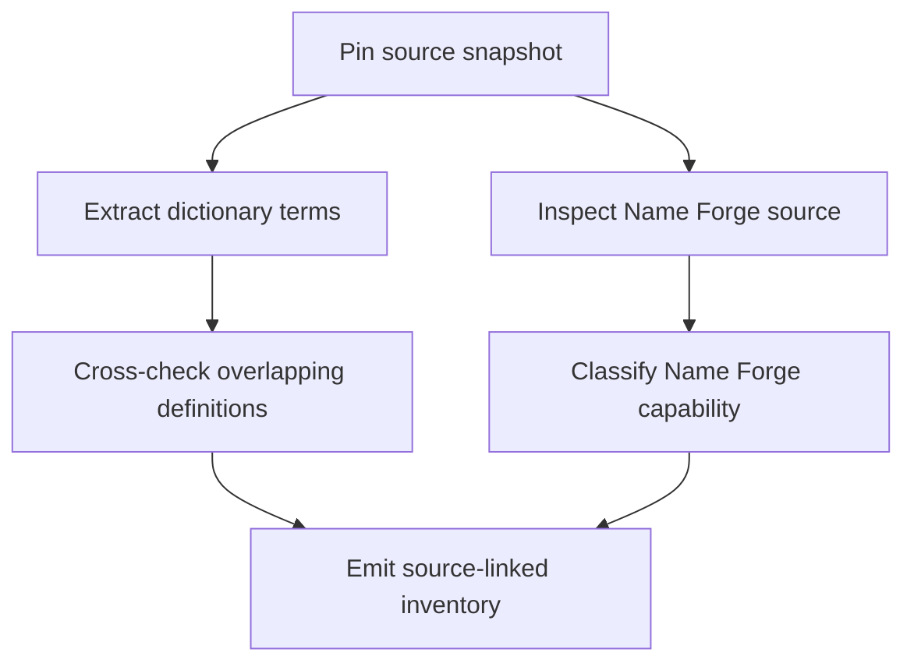

# Grimoire Craft — Worked Recipe Example

**Example:** `software-recipe/grimoire/craft-inventory`  
**State:** candidate description; not executed  
**Work mode:** read-only source inspection

This example demonstrates the minimum useful Cauldron/workbench flow without inventing a new runtime. It composes a small source-inspection procedure from existing Grimoire assets and expresses it using the neutral SRM schema.

## Inputs found in the repository

| Ingredient | Source-defined role | Use in this recipe |
|---|---|---|
| `harmony_hub/config/GRIMOIRE_DICTIONARY.md` | 1337SP3@K ↔ Grimoire ↔ Orchestra crosswalk | Preserve canonical spell/Orchestra terms and definitions |
| `harmony_hub/config/grimoire/1337_D1CT10N4RY.md` | Grimoire v2.0 character substitutions, core castings and protocol | Extract Spellbook, Rune, Transmute, Scry, Probe, Echo, Grimoire and Phylactery |
| `archwiz/name_forge.py` | Source describes “Name Forge — suggest tool names from the full ArchWiz Grimoire” | Classify the existing tool accurately; do not mistake it for a recipe composer |

The first dictionary defines, among other entries, Transmute = code refactoring, Scry = code review, Probe = API endpoint testing, Echo = fragment matching, Incantation = reusable CLI spell, Cast = execute, and Grimoire = all spells/history. The protocol dictionary separately defines Spellbook = task queue, Rune = prompt template, and Phylactery = backup. The recipe preserves each source's own wording rather than silently merging the two tables.

The inspected Name Forge source reads the protocol dictionary's Core Castings and Grimoire Protocol tables, scores term/meaning/leet matches against concept words, and prints up to ten suggestions. That is name suggestion, not general external collision scanning, recipe composition, or name clearance.

## Composition graph

The graph describes a candidate procedure. No commands, spells, APIs, scripts, or repository mutations are executed by this worked example.

## Workbench stages

1. **Gather:** resolve the two Grimoire dictionaries and optional Name Forge source at the pinned repository revision.
2. **Scry:** inspect exact source rows and code; attach immutable source references and Git blob IDs.
3. **Prepare:** reject missing required source references. Do not fill absent definitions from model memory.
4. **Compose:** represent extraction, source classification, cross-checking, and report emission as typed SRM operations with explicit dependencies.
5. **Probe:** review required invariants: every term has a source row; conflicts remain visible; no source is modified; no spell is cast.
6. **Record:** keep the recipe as a candidate SRM artifact. A later actual experiment/run would be recorded through the existing canonical DoE/orchestration evidence contracts, not a new Cauldron ledger.

## Evidence and digest conventions

- The example's `revision` is SHA-256 over canonical JSON of the recipe object with the `revision` property omitted; keys are sorted, separators are compact, and UTF-8 is used.
- Source `digest` values shown here are the GitHub file/blob SHAs returned by source inspection (40-character Git object IDs), not SHA-256 file digests. They are retained as immutable source identifiers.
- The pinned commit identifies the inspected repository snapshot. It is not evidence that the files were newly changed by this proposal.
- The recipe's evaluation status is `not-run`. Its candidate status is not a validation or admission claim.

## Existing contract reuse

The SRM artifact references:
- `SRM-SCHEMA.json` for the recipe's structure;
- `ORCHESTRATION-TREATMENT.schema.json` and `ORCHESTRATION-RECEIPT.schema.json` for any future orchestration-pattern and cycle-observation mapping;
- `docs/ops/corpus/EXPERIMENT.schema.json` for any future preregistered comparison.

These references do not create a new treatment, receipt, experiment, or runtime instance.

## What this proves—and does not prove

**Demonstrated:** the existing Grimoire sources can be represented as ingredients in a provenance-aware SRM candidate; their definitions can be composed into a read-only procedure; Name Forge can be accurately scoped from its source.

**Not demonstrated:** a deployed Cauldron, automated parser, runtime execution, CI validation of SRM, owner approval, name clearance, performance benefit, or permission to execute recipes.

## Review questions

- Should Rune and Incantation remain vocabulary aliases only, or should a future owner-approved adapter map specific prompt/CLI assets into typed SRM ingredients?
- Which existing source owner should own any automated extraction adapter?
- Which existing admission contract should receive a candidate recipe after independent validation?
- Is a visual workbench useful enough to justify a UI, or is a CLI/report projection sufficient?

Do not create a new service, registry, Brain, scheduler, or execution plane to answer these questions.
