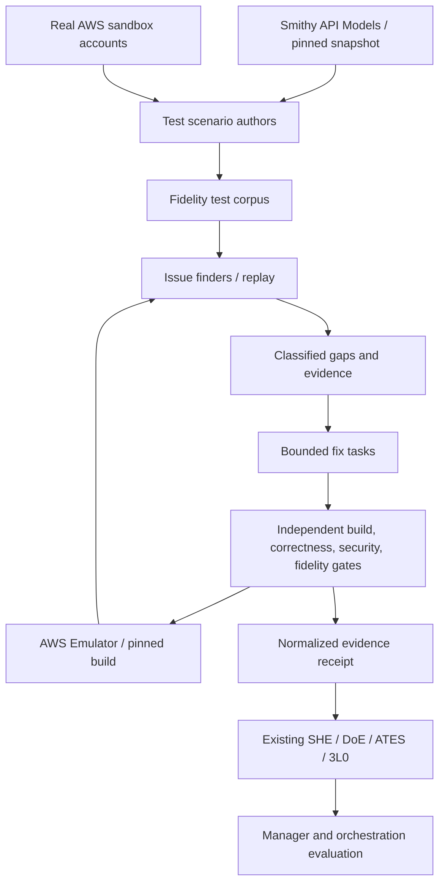

# Cloud Emulator Fidelity Lane

**Lane ID:** `cloud-emulator-fidelity`  
**Status:** research lane registered; runtime integration not yet validated  
**Owner:** termux-monorepo management hub  
**Partner lane:** Research-Astute  
**Evidence authority:** repository-native experiment records and redacted run receipts  
**Initial focus:** AWS Emulator, AWS API Models (Smithy), AWS Emulator Evaluation Suite

## 1. Purpose

Establish a reproducible, resource-aware evaluation lane for local cloud emulators and agent-driven cloud application development.

The objective is not to replace AWS, LocalStack, mocks, SAM, CDK, or existing development workflows. It is to measure which test surface catches which classes of defects, how closely a local emulator matches the real service for explicitly covered behavior, and whether faster feedback improves integrated engineering outcomes without creating false confidence.

The lane studies both:
- **Emulator fidelity:** how the emulator's observable API behavior compares with AWS for a pinned set of scenarios.
- **Agent-loop effectiveness:** whether agents can use the emulator to discover, diagnose, and fix application defects faster and more reliably.

## 2. Research findings

### 2.1 AWS's agent-built emulator

AWS describes AWS Emulator as a local API endpoint whose service implementations are generated from published AWS API models. Its launch documentation describes hundreds of API models/services, per-instance ports/keys/in-memory state, SDK and CLI compatibility, and explicit fidelity reports. Unsupported operations return `501 Not Implemented`; this must be treated as unsupported, not as a passing result.

AWS's published build methodology separates the work into three bounded teams:

1. **Test authors:** derive scenarios from Smithy API models and verify those scenarios against real AWS.
2. **Issue finders:** replay the saved fidelity suite against the emulator, identify divergences, and group likely common causes.
3. **Fixers:** take one bounded issue, implement a correction, and pass independent build, correctness, security, and fidelity gates.

The transferable lesson is not "spawn thousands of agents." It is to make the specification executable, build a reusable oracle-backed test corpus, assign bounded work, and make independent gates authoritative. This aligns with the existing Manager / Team Conductor / Build / Review / Integration / Evidence Index architecture and the existing WAIT → WATCH → VALIDATE → RE-FETCH → COMPARE loop.

### 2.2 API models are contracts, not implementation proof

`aws/api-models-aws` contains generated Smithy models in JSON AST form, organized by service SDK ID and service version. The upstream README says the repository is generated from other sources and is not closely monitored; it directs model issues to other channels and does not accept model PRs.

Use these models to:
- inventory service and operation shapes;
- identify required/optional members, traits, protocols, and modeled errors;
- generate candidate test scaffolds or coverage inventories;
- pin the contract snapshot used by each experiment.

Do not infer that a model's presence means the emulator implements the operation or matches its behavior. Only an executed fidelity test can establish tested behavior.

### 2.3 The evaluation suite is a separate evidence asset

The AWS Emulator Evaluation Suite describes each fidelity test as a short Python program using boto3. Tests assert resulting resource state and, where applicable, error code/message. Its README says included tests were verified against at least two sandboxed AWS accounts and that uncovered behavior is not verified.

The runner distinguishes:
- `passed` (exit 0);
- `failed` (exit 11; assertion or timeout);
- `error` (exit 12; unexpected execution problem or missing tool);
- invalid input (exit 2);
- strict cleanup failure (exit 13).

The runner uses loopback-only endpoints and emulator-generated keys, and removes ambient AWS credentials, profiles, and proxy settings from the fidelity test process. It does not restrict network access of tools or containers a test starts. Retain this distinction in threat models.

Both upstream AWS Emulator and AWS Emulator Evaluation Suite declare restrictive contribution policies in their READMEs. The user-owned forks currently point at the same observed upstream HEAD commits; they are tracking mirrors, not independent code changes. At the 2026-11-16 observation, both the emulator fork and upstream were at `813af480bf7f16d5418b64e4f5644a74a7da11c5`; both evaluation-suite repositories were at `4df2823bafface2ada35f482c07ff6668cc078e1`. Keep upstream assets read-only unless a distinct, reviewed local extension is intentionally developed in a separate repository.

Licensing must be checked per asset: AWS Emulator is CC0 1.0 except vendored code under Apache-2.0; the evaluation suite is CC0 1.0; AWS API Models are Apache-2.0; Agent Toolkit for AWS is Apache-2.0. Do not infer that adjacent AWS repositories share one license; inspect each repository's LICENSE and third-party notices before redistribution.

## 3. Reference architecture

### Authority boundaries

| Surface | Authority | Must not become |
|---|---|---|
| AWS Smithy API Models | API contract source | proof of implementation/fidelity |
| Real AWS sandbox | behavioral reference for tested scenario | unrestricted production credential source |
| AWS Emulator | local execution under test | production or security oracle |
| AWS Evaluation Suite | upstream behavioral test asset | universal coverage claim |
| Local project cohort | project-specific outcome evidence | duplicate canonical ledger |
| SHE / DoE / experiment schema | canonical evidence and experiment record | vendor-dashboard mirror |
| Human/repository promotion policy | merge and production authority | automatic emulator pass-through |

## 4. Resource and repository register

| Resource | Role in this lane | Current disposition | License / reuse note |
|---|---|---|---|---|
| [aws/aws-emulator](https://github.com/aws/aws-emulator) | Local AWS API emulator; Rust workspace, one crate per service | upstream reference; no upstream PRs | CC0-1.0; `vendor/` Apache-2.0 |
| [aws/api-models-aws](https://github.com/aws/api-models-aws) | Generated Smithy JSON AST service models | pinned contract input; generated/read-only | Apache-2.0 |
| [aws/aws-emulator-evaluation-suite](https://github.com/aws/aws-emulator-evaluation-suite) | Boto3 fidelity scenarios and runner | upstream test corpus; read-only | CC0-1.0 |
| [timerloggedout-spec/aws-emulator_fork](https://github.com/timerloggedout-spec/aws-emulator_fork) | User-owned upstream mirror | HEAD matched upstream at observation | inherited upstream files; inspect vendored notices |
| [timerloggedout-spec/aws-emulator-evaluation-suite_fork](https://github.com/timerloggedout-spec/aws-emulator-evaluation-suite_fork) | User-owned upstream mirror | HEAD matched upstream at observation | CC0-1.0 |
| [aws/agent-toolkit-for-aws](https://github.com/aws/agent-toolkit-for-aws) | Agent skills, plugins, AWS MCP setup | integration/skill research | Apache-2.0 |
| [aws/aws-sam-cli](https://github.com/aws/aws-sam-cli) | Serverless build and local Lambda/API workflow | application integration candidate | verify at adoption |
| [aws/aws-cdk](https://github.com/aws/aws-cdk) | Infrastructure definition and CloudFormation synthesis | IaC integration candidate | verify at adoption |
| [aws/jsii](https://github.com/aws/jsii) | Cross-language bindings for TypeScript libraries | SDK/toolchain context | verify at adoption |
| [aws/eks-pod-identity-agent](https://github.com/aws/eks-pod-identity-agent) | EKS workload credential delivery | identity/security boundary research; not emulator parity | verify at adoption |
| [aws/aws-advanced-python-wrapper](https://github.com/aws/aws-advanced-python-wrapper) | Aurora/RDS-aware Python driver wrapper | database integration research; not a core emulator dependency | verify at adoption |
| [aws/c3r](https://github.com/aws/c3r) | AWS Clean Rooms client-side cryptographic data processing | specialized data-security research | verify at adoption |
| [aws/csi-components](https://github.com/aws/csi-components) | Kubernetes CSI sidecar image tooling | Kubernetes/storage integration research | verify at adoption |
| [timerloggedout-spec/event-ruler_fork](https://github.com/timerloggedout-spec/event-ruler_fork) | User-owned Event Ruler fork | compare only if event-pattern semantics are in the target workflow | verify fork and upstream license |
| [aws/aws-kotlin-repo-tools](https://github.com/aws/aws-kotlin-repo-tools) | Kotlin SDK repository tooling | language/tooling context | verify at adoption |
| [aws](https://github.com/aws) | AWS public repository discovery | catalog, not a dependency | repository-specific |
Do not clone all of these repositories into the Termux home checkout. Add only a resource record and a bounded evidence pointer when a concrete experiment requires it.

## 5. Tool and emulator comparison

| Surface | Best question it answers | Known boundary |
|---|---|---|
| Unit mocks/stubs | Is our own logic correct for the cases we modeled? | Mock author may omit real service behavior |
| AWS Emulator | Does the application interact correctly with supported AWS API behavior locally? | Not all behavior is implemented or verified; no IAM-equivalent security test |
| LocalStack | Does a local cloud-development workflow work in the selected LocalStack edition/version? | Product features, access model, licensing, and distribution are version-specific |
| SAM CLI local | Does a Lambda/API application run in the local runtime workflow? | Not a complete AWS cloud service emulator |
| Real AWS sandbox | Does the workflow behave against actual service behavior and account/Region controls? | Slower, costs/cleanup, quota and credential governance |

Run parallel comparisons before considering replacement. LocalStack's own roadmap describes a move to a unified account-based distribution, with a free plan intended for non-commercial use and reduced ongoing maintenance of the old Community edition. Record the exact LocalStack image/CLI version and applicable plan/license in every comparison.

## 6. Safety and reproducibility contract

AWS Emulator is for development and testing. It is not a production runtime and must not be used to test IAM/security controls. AWS documents gaps including IAM policy evaluation and cross-account/cross-Region behavior; additional launch coverage gaps include quotas, throttling, outages, and some data-plane behavior.

Required controls for our experiments:

1. **Loopback only.** Bind and call the emulator only on loopback. Do not expose the emulator listener to LAN, public networks, or shared tunnels.
2. **No real AWS credentials.** Do not pass real profiles, access keys, session tokens, credential files, or production environment variables into emulator test jobs.
3. **Generated test credentials only.** Use the emulator's own generated credentials and CA material; isolate the emulator home per test run.
4. **Telemetry off by default for experiments.** Set `EMULATOR_TELEMETRY=off` or the documented process/config equivalent, and record the setting. AWS Emulator telemetry is enabled by default.
5. **Test-process containment.** The suite's runner strips ambient credentials and enforces loopback endpoints, but it does not sandbox arbitrary subprocesses or containers launched by a test. Do not run unreviewed tests with secrets or broad host mounts.
6. **Real AWS only in a dedicated sandbox.** Use least-privilege, short-lived, budgeted credentials and explicit cleanup. Sandbox validation is a separate tier.
7. **No false security claims.** A local pass does not prove IAM authorization, isolation, resilience, Region parity, quota behavior, or production readiness.
8. **Provenance.** Pin source commit/release, model snapshot, suite commit, SDK/CLI version, runner version, OS/architecture, configuration, and test ID.
9. **Failure semantics.** Preserve pass/fail/error/skip/unsupported/not-tested separately. Missing evidence is unknown, never zero or pass.
10. **No secret or payload retention.** Receipts retain identifiers, hashes, outcome codes, timings, and redacted summaries only; no credentials, raw request/response bodies, or customer data.

## 7. Proposed staged implementation

### Stage 0 — source and environment admission

- [x] Register `cloud-emulator-fidelity` in the research lane registry.
- [x] Add the evaluator to the agent evaluation lane taxonomy as observational.
- [x] Record upstream read-only contribution constraints and fork synchronization status.
- [ ] Pin a release tag/commit for the first bounded run.
- [ ] Verify remote runner disk, CPU, architecture, and package availability.
- [ ] Confirm the chosen runner can install the release without a full source build.

**Resource gate:** upstream documents approximately 100 GB free disk for a full source build. Do not build the full Rust workspace on Android/Termux. Prefer a release package or isolated remote runner. Stop if disk or memory headroom is inadequate.

### Stage 1 — bounded fidelity smoke cohort

Select only services used by a concrete target application. Do not attempt an all-services build or all-suite run as the first experiment.

- Run a small, representative set of upstream fidelity tests.
- Give every stateful test its own emulator instance and isolated home.
- Capture runner verdict, cleanup verdict, exact versions, service/operation, and duration.
- Confirm the same test's upstream expected behavior is documented as verified against AWS.
- Re-fetch and independently validate the report before recording it.

### Stage 2 — project-specific comparison

For one target application, compare the same frozen scenario cohort across:
- mocks/stubs;
- AWS Emulator;
- LocalStack at a pinned version/plan, if available;
- SAM local where Lambda/API runtime behavior is relevant;
- real AWS sandbox.

Record scenario coverage, assertion outcomes, false confidence risks, setup time, execution time, cleanup, resource cost, and developer/agent intervention.

### Stage 3 — agent-team experiment

Use bounded role separation:
- **Spec/test author:** proposes scenarios from Smithy models and existing app requirements; cannot self-certify real-AWS fidelity.
- **Differential investigator:** reproduces emulator divergence and groups root causes; cannot merge fixes.
- **Fix implementer:** receives one bounded issue; cannot change the oracle or waive a failing gate.
- **Independent reviewer/gates:** validates correctness, security, and regression behavior.
- **Conductor:** admits work, enforces single-writer ownership, and records provenance.

Parallelize across independent service/operation failures, not multiple agents editing the same shared root cause. Preserve the existing repository single-writer and review-ownership controls.

### Stage 4 — normalized evidence and DoE

Use the existing `docs/ops/corpus/EXPERIMENT.schema.json` and canonical evidence receipts. Do not create a second experiment schema or new event bus.

Candidate outcomes:
- task correctness and integration success;
- fidelity coverage and verified operation count;
- divergence count/severity;
- unsupported/untested coverage;
- time-to-first-feedback and time-to-integration;
- retries, conflicts, duplicate work, and human intervention;
- cleanup success and residual resources;
- compute/disk/network cost;
- security control coverage (measured only in real AWS or dedicated security tests).

ATES/WTCV/TCV are supporting execution measures, not quality substitutes. A faster local pass cannot outweigh a correctness or security regression.

No DoE campaign is admitted or executed by this document. A separate preregistration and actual run evidence are required under the existing DoE family intake contract.

## 8. Acceptance gates

A first bounded cohort is eligible for review only when:

- source, model, suite, runner, SDK, and environment versions are pinned;
- every test has a stable ID and a classified terminal verdict;
- emulator unsupported responses are not counted as passes;
- test isolation and cleanup are verified;
- no real credentials or sensitive payloads enter the process or artifacts;
- a sample of scenarios has independent real-AWS oracle provenance;
- local-versus-real differences are explicit;
- report hashes and source SHA are recorded;
- repository-native validation and human review remain authoritative.

A green local suite is not a release or production promotion signal by itself.

## 9. Immediate next work

1. Choose one existing application/service path in the monorepo that actually uses AWS APIs.
2. Select only the required services and 5–20 representative upstream fidelity tests.
3. Execute on a resource-adequate remote runner using a pinned release.
4. Record a first immutable, redacted experiment receipt.
5. Compare one alternative local surface only after the AWS Emulator baseline is reproducible.
6. Review whether the result adds decision value before expanding scope.

## 10. Sources and research trail

### Primary AWS sources
- AWS Emulator: https://github.com/aws/aws-emulator
- AWS Emulator user guide: https://docs.aws.amazon.com/emulator/latest/userguide/
- AWS Emulator availability announcement: https://aws.amazon.com/about-aws/whats-new/2026/11/aws-emulator-now-available/
- How autonomous agents built AWS Emulator: https://www.aboutamazon.com/news/aws/how-autonomous-ai-agents-built-aws-emulator
- AWS API Models (Smithy JSON AST): https://github.com/aws/api-models-aws
- AWS Emulator Evaluation Suite: https://github.com/aws/aws-emulator-evaluation-suite
- Agent Toolkit for AWS: https://github.com/aws/agent-toolkit-for-aws
- AWS Agent Toolkit skills: https://github.com/aws/agent-toolkit-for-aws/tree/main/skills

### Independent reporting and comparison
- GeekWire launch report: https://www.geekwire.com/2026/aws-gives-developers-a-free-local-stand-in-for-its-cloud-built-from-scratch-by-ai-agents/
- InfoWorld launch and limitations: https://www.infoworld.com/article/4247383/aws-unveils-local-emulator-service-to-help-enterprises-accelerate-app-development-and-testing.html
- LocalStack response: https://blog.localstack.cloud/aws-emulator-is-here-what-you-need-to-know/
- LocalStack distribution roadmap: https://blog.localstack.cloud/the-road-ahead-for-localstack/

### Agentic engineering context
- Anthropic parallel C compiler research: https://www.anthropic.com/research/building-c-compiler
- Amazon engineering role guidance: https://www.aboutamazon.com/news/company-news/amazon-software-engineer-role-guideline-ai
- AWS CEO on AI inference and task-accomplishing agents: https://www.aboutamazon.com/news/aws/aws-ceo-ai-inference-transforms-developer-capabilities
- GeekWire on Amazon's AI-era engineering playbook: https://www.geekwire.com/2026/amazon-rewrites-its-software-engineering-playbook-for-an-era-when-ai-writes-the-code/

### Adjacent AWS projects
- AWS repositories: https://github.com/aws
- EKS Pod Identity Agent: https://github.com/aws/eks-pod-identity-agent
- AWS Advanced Python Wrapper: https://github.com/aws/aws-advanced-python-wrapper
- AWS SAM CLI: https://github.com/aws/aws-sam-cli
- C3R: https://github.com/aws/c3r
- jsii: https://github.com/aws/jsii
- CSI Components: https://github.com/aws/csi-components
- AWS CDK: https://github.com/aws/aws-cdk
- Event Ruler fork: https://github.com/timerloggedout-spec/event-ruler_fork
- AWS Kotlin Repo Tools: https://github.com/aws/aws-kotlin-repo-tools

### User-provided visual assets
- https://assets.aboutamazon.com/dims4/default/770f29a/2147483647/strip/true/crop/1600x900+0+0/resize/767x431!/quality/90/?url=https%3A%2F%2Fassets.aboutamazon.com%2F2b%2F9c%2F38699c294dba9a69b27d004d9729%2Faws-emulator-ai-1-amazonnews-cdlt-09102026.jpeg
- https://assets.aboutamazon.com/dims4/default/f58c09b/2147483647/strip/true/crop/1600x900+0+0/resize/767x431!/quality/90/?url=https%3A%2F%2Fassets.aboutamazon.com%2Ffd%2F1e%2F3401edd44b5397d0120a11ec9f00%2Faws-emulator-ai-2-amazonnews-cdlt-09102026.jpeg

## 11. Status discipline

- **DESIGNED:** this lane charter and its evidence/safety boundaries are documented.
- **REGISTERED:** lane appears in the research and evaluator registries.
- **EXECUTED:** only after a real bounded runner invocation is observed.
- **VALIDATED:** only after its exact reports, cleanup, provenance, and independent checks are inspected.
- **PROMOTED:** only through the existing repository/human promotion process.

Do not report execution, fidelity coverage, security validation, or production readiness from repository registration or documentation alone.
