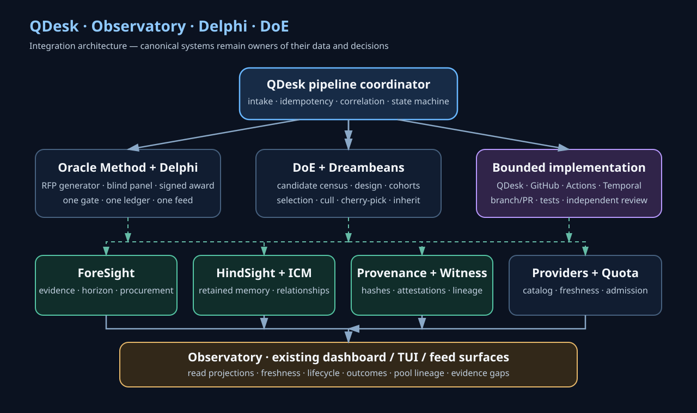
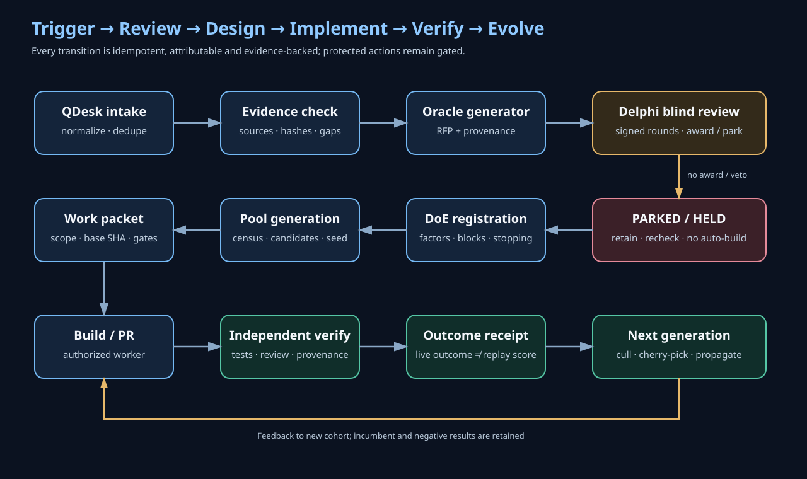

# QDesk Observatory + Delphi + DoE — Design and Integration Map

## Architectural rule

The QDesk pipeline is a coordinator and adapter layer. Existing systems remain authoritative for their domains:

| Domain | Source of truth |
|---|---|
| RFP evaluation, votes, awards | Delphi gate signed issue ledger |
| RFP presentation | `delphi-rfp-feed/v1` and existing collector |
| Proposal generation | Oracle Method generator + PROVENANCE.json |
| Experiment design and campaign registration | DoE family, DESIGN records, Questions Matrix |
| Candidate inventory | Dreambeans pool census and source-card refs |
| Research evidence | ForeSight Evidence Spine |
| Retained operational memory | HindSight |
| Agent/context relationships | Existing ICM / context relationship graph |
| Workflow execution | GitHub Actions / Temporal engagement receipts |
| Provider eligibility and capacity | Provider catalogue, quota registry, quota readings, routing policy |
| Telemetry and quality | OpenTelemetry adapters, ATES, 3L0, Witness / provenance receipts |
| Operator presentation | Existing Observatory / Tribute surfaces |

## System topology

## Trigger-to-evolution lifecycle

## Event contract (proposed additive schema)

`qdesk.pipeline-event/v1`

Required fields:

- `event_id`: unique event identity.
- `request_id`: stable QDesk request identity.
- `correlation_id`: trace across issue, workflow, PR and artifacts.
- `event_type`: normalized lifecycle event.
- `occurred_at` and `observed_at`: distinct clocks.
- `actor`: actor type, actor id, role and moniker; provider/model identity separate.
- `source_refs[]`: issue, PR, commit, document or artifact refs.
- `input_sha256` / `output_sha256`: canonical content fingerprints where applicable.
- `state_before` / `state_after`.
- `evidence_refs[]` and `confidence`.
- `authorization_class` and `spend_class`.
- `idempotency_key`.

Unknown values must be explicit; no empty field may silently mean zero, success or permission.

## Candidate evaluation

Candidate scoring is multi-axis, not a single opaque scalar:

1. Evidence quality and traceability.
2. Mechanism fit to the DoE substrate.
3. Reproducibility and determinism.
4. Measurability / availability of an independent oracle.
5. Feasibility and implementation cost.
6. Expected utility and compounding potential.
7. Security, privacy and domain-transfer risk.
8. Novelty and complementarity to existing pool members.

The score is a triage aid. Hard constraints (prohibited transfer, missing source, no measurable oracle, unbounded cost) can park or reject a candidate regardless of weighted score. Weights and thresholds are versioned and experimentally validated; do not invent a score threshold in code before a registered calibration campaign.

## Generator design

The generator should be a pure, offline-capable transformation:

`pinned census + source evidence + versioned rubric + design config + seed → candidate pool + experiment design + provenance receipt`

It must emit:
- normalized candidate records;
- duplicate groups and flags;
- eligibility/parking reasons;
- strata and blocks;
- randomized assignments;
- factor/level matrix;
- expected sample counts and limitations;
- generator version, seed, input hashes and output hash;
- reproducibility manifest.

No network calls, model calls, secret access or provider inference occur inside the deterministic generator. Acquisition and enrichment are separate, explicit upstream stages.

## Evolution and selection discipline

- Incumbent candidates remain in the pool.
- Preserve the complement/exploration cohort.
- Culling is based on predeclared evidence and minimum sample conditions.
- Cherry-picks are narrow, attributable features—not wholesale candidate replacement.
- Propagation creates a new version with parent lineage.
- Failed candidates and negative outcomes remain queryable.
- Replay scores are distinct from live online outcomes.
- Independent verification precedes promotion.

## Observability contract

Every pipeline stage emits a correlated event and a provenance receipt. The Observatory reads canonical feeds and records; it does not become a write authority for Delphi or DoE.

Recommended views:
- request/issue/PR timeline;
- RFP award and review history;
- experiment design and allocation matrix;
- candidate pool and lineage graph;
- implementation and verification evidence;
- provider/quota readiness;
- telemetry and workflow traces;
- generation comparison and cull/propagation history.

## Proposed role separation

| Role | Responsibility | Cannot do alone |
|---|---|---|
| QDesk intake coordinator | Normalize request and route | Award or promote |
| Oracle Method generator | Deterministic proposal artifacts | Invent evidence or cast ballots |
| Delphi gate | Review and award | Authorize paid/prod changes |
| DoE design steward | Register factors, cohorts and stopping rules | Change outcome after observing it |
| Pool curator / Scout | Triage candidate methods | Convert title-level triage into verified fitness |
| Builder | Implement accepted work packet | Independently approve own change |
| Reviewer | Review implementation and tests | Alter source evidence |
| Independent verifier | Reproduce tests and evidence | Rewrite the candidate being verified |
| Provenance steward | Validate attribution and hashes | Assert correctness from provenance alone |
| Operator / authorizer | Approve protected actions | Manufacture evidence or ballots |

## Failure and recovery

- Duplicate trigger: idempotency-key collision → reconcile to existing request.
- Partial source census: mark incomplete and refuse to publish a complete pool.
- Missing source evidence: park as UNVERIFIED.
- Quota unknown/stale: defer provider execution; deterministic local work may continue.
- Delphi parked: retain RFP and schedule only the gate-defined recheck; no implementation auto-start.
- Generator mismatch: preserve both outputs, fail validation and do not overwrite.
- Workflow cancellation: resume from durable receipt, not in-memory assumptions.
- Builder/verifier conflict: require a distinct verifier.
- Provenance failure: hold promotion; retain diagnostic artifact.
- Regression: revert candidate branch or preserve incumbent; never mutate the incumbent in place.

## Integration sequence

1. Read current contracts and derive a versioned interface delta.
2. Build fixtures from existing RFP, ledger, segmentation and candidate records.
3. Implement the pure generator and validate deterministic outputs.
4. Wire the trigger to the existing Delphi issue/event contract.
5. Wire post-award work packets to QDesk / Actions / Temporal with permissions.
6. Add Observatory projections to existing feeds.
7. Run a shadow-only pilot with no provider inference and no paid spend.
8. Compare outcomes and promote only after independent validation.
