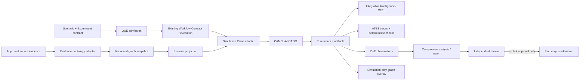

# Design — Simulation Intelligence Plane

**Design ID:** SIP-DESIGN-001  
**Status:** proposed architecture; initial contracts under construction  
**Design principle:** reuse existing control and evidence planes; isolate simulation semantics.

## 1. Architecture at a glance

The simulation lane is a workload and domain adapter, not an authority plane. The arrows into QUE indicate admission; QUE remains outside the simulation runtime and owns dispatch.

## 2. Existing substrate reuse

| Concern | Canonical existing system | SIP responsibility |
|---|---|---|
| Proposal intake / admission | QUE / QDesk / proposal lifecycle | Submit a declarative request; never self-admit |
| Task dependencies | Workflow Contract / existing DAG planner | Supply a valid WFC instance; no second planner |
| Provider inventory | Integration Intelligence registry | Add provider entries only after registry review |
| Normalized events | CEEL / integration-event schema | Map lifecycle and result observations |
| Experiment design | DoE family | Define factors and frozen cohort; emit existing experiment records |
| Execution measurement | ATES | Map engine events to trace/span contract; deterministic checks first |
| Graph analytics | Delphic / existing graph tools | Reuse projections; do not duplicate algorithms |
| Visualization | SHE / Tribute / Observatory | Project sanitized feeds; no dashboard-owned truth |
| Long-running execution | QUE-selected existing execution surface | Adapter supports recoverable process semantics; Temporal only if justified by DoE |
| Agent orchestration | Existing LangGraph integration and escalation contracts | Reuse existing implementation; compare orchestration alternatives only if a concrete gap remains |
| ABM research references | DoE family / SFI ABM corpus | Mesa remains pre-screen-only; NetLogo corpus presence is not runtime proof; Repast remains research-only |
| Prior durable-execution evaluation | Temporal RFP #1885 and recorded pass | Reuse existing Temporal implementation/evidence; no duplicate RFP |

## 3. Component boundaries

### 3.1 Evidence and graph preparation
Input: allowlisted source-evidence references and a graph snapshot reference.
Output: ontology extraction record, entity/relation candidates, provenance links, graph snapshot digest, rejected/ambiguous items and extraction configuration.
Must preserve source claims as claims; inferred edges are labeled derived; synthetic edges are labeled simulated. Graph snapshots are immutable.

### 3.2 Persona projection
Each persona is a synthetic experimental construct. Store:
- stable synthetic persona ID scoped to a run/cohort;
- source evidence references;
- grounded attributes and confidence/attribution;
- generated attributes with generator/model/prompt hash;
- explicit assumptions, missingness and uncertainty;
- policy/action capabilities and prohibited actions;
- no real-person identity resolution.

A persona must not be described as a real individual. Sensitive attributes are excluded unless a reviewed research protocol explicitly requires them and has appropriate data authority.

### 3.3 Scenario and experiment contract
Scenario describes the simulated world and its assumptions. Experiment describes the comparison: arms, factors, levels, cohort, seed plan, outcome rubric and resource ceilings. The two are separate immutable objects.

### 3.4 Engine adapter
Provider-neutral operations:
- `capabilities()`
- `validate_request()`
- `prepare()`
- `start()`
- `observe()`
- `request_stop()`
- `finalize()`
- `health()`

Each operation returns a typed result with engine request/run IDs, timestamps, adapter version, status and evidence references. The adapter does not own admission, scheduling or retry policy. The execution host owns process supervision; the adapter reports engine state. Unsupported operations must be explicit, not simulated as success.

### 3.5 OASIS execution
OASIS is the first execution candidate, not a hard dependency of schemas or offline tests. Pin the release and platform configuration. Test environment reset/step/close, DB persistence, action semantics, agent activation, recommendation dynamics, multi-platform coordination and process termination. Treat OASIS-generated content as synthetic and untrusted.

### 3.6 MiroFish-compatible workbench workflow
Use MiroFish as a workflow reference for source ingestion, graph/persona preparation, OASIS run orchestration and report/interview surfaces. The refactored fork's workbench-core/resource-adapter/tool/API-shell separation is a design reference. Keep any upstream-specific adapter thin and isolated. No AGPL code copied into this repository until license review is completed.

## 4. Run lifecycle

Canonical SIP lifecycle:
`draft → prepared → admitted → queued → starting → running ↔ paused → stopping → finalizing → completed`
Terminal alternatives: `failed`, `cancelled`, `blocked`.

Rules:
- `completed` means engine completion and successful finalization, not merely an application event or a process still waiting for IPC.
- Platform-level completion must be reconciled across every platform before run completion.
- A process may remain alive for interview/IPC after simulation completion; that state is `completed_with_session_open` or `finalizing`, never falsely `running` and never falsely `completed` until finalization policy is met.
- A monitor detects stale status and dead consumers independently.
- Stop is idempotent; cleanup is bounded; partial evidence is preserved.
- Every state transition is an append-only event.

## 5. Data and trust model

Three graph layers:
1. `source_graph`: evidence-backed, immutable source claims and observed relationships.
2. `derived_graph`: extracted or inferred relationships, labeled with method, confidence and evidence.
3. `simulation_overlay`: agent-created interactions and state changes, scoped to run/experiment.

No implicit overlay-to-source merge. A proposed promotion must include independent evidence, provenance, review decision and a new event. Simulation output alone can never satisfy this gate.

Every report statement has a claim class: `source_observed`, `derived_inference`, `simulation_observation`, `model_interpretation`, or `unknown`.

## 6. Reproducibility manifest

Minimum fields:
- scenario ID/version/digest;
- experiment ID/version/digest;
- source cohort ID and evidence manifest digest;
- graph snapshot ID/digest and graph builder version;
- persona generator/model/prompt hash and persona set digest;
- engine name/version, adapter name/version, platform and DB schema version;
- repository commit SHA, runtime/container fingerprint and dependency lock digest;
- model/provider IDs and resolved model versions (no secret values);
- seed and randomization method;
- activation probability, steps, agent count and policy configuration;
- resource ceilings and actual usage (tokens, cost, wall time, memory/storage where measurable);
- lifecycle transitions, errors, artifact digests and validator outcomes.

A manifest must record unknowns as null/unknown, not infer values.

## 7. Reliability and process supervision

Test at minimum:
- subprocess exits before first event;
- subprocess remains alive after all platform completion events;
- IPC listener remains open for interview after simulation completion;
- process crashes during a step;
- duplicate/out-of-order events;
- DB locked/unavailable;
- partial report finalization;
- graph service timeout/retry;
- one platform completes while another is still active;
- stop request races with completion;
- stale monitor heartbeat;
- adapter restart and run recovery.

The MiroFish upstream issue set contains examples of these lifecycle and finalization hazards. The adapter must explicitly model engine completion separately from process liveness and post-run session availability.

## 8. Security, privacy and resource controls

- Read-only source ingestion by default; allowlisted URIs and file types.
- No arbitrary URL fetch, shell command, code execution or prompt-supplied tool activation.
- No public social-platform writes; OASIS environments are local/sandboxed.
- Synthetic IDs; no attempt to resolve them to real people.
- PII minimization and sensitive-attribute exclusions.
- Bounded agents, steps, activation probability, concurrent runs, wall-clock time, token budget and monetary spend.
- Secret values remain in runtime secret stores; event records contain variable names/opaque references only.
- Raw prompts/completions are excluded from canonical telemetry unless an explicitly approved restricted artifact protocol exists.
- Kill switch and idempotent stop/finalize behavior.
- External source content and generated personas are untrusted input.

## 9. Alternative architecture comparison

| Candidate | Role | Strength | Main risk / cost | Initial disposition |
|---|---|---|---|---|
| CAMEL-AI OASIS | Social simulation engine | Platform-oriented agent actions and environment dynamics | Runtime complexity, token cost, process lifecycle and version churn | Primary pilot candidate |
| MiroFish workflow | Graph-to-simulation workbench | End-to-end reference pipeline | AGPL boundary, coupled services and deployment assumptions | Architecture reference / isolated adapter |
| Mesa | ABM framework | Python-native model control and deterministic baseline potential | Social-network platform behavior must be built | Mandatory alternative candidate |
| NetLogo / Repast | ABM environments | Mature modeling paradigms | Integration and automation overhead | Research comparison |
| Custom deterministic simulator | Offline baseline | Fully controlled, cheap, fixture-friendly | Limited ecological validity | Required test oracle |
| LangGraph / AutoGen / CrewAI / Agents SDK | Agent orchestration | Tool/agent composition | Not equivalent to social environment semantics | Optional orchestration comparison |
| Temporal | Durable execution | Recovery and workflow durability | Adds infrastructure and risks duplicate orchestration | Conditional, not default |

## 10. Integration points and no-duplication rules

- Use QUE's existing admission/dispatch; do not implement a queue.
- Use WFC for task and dependency expression; do not create a parallel workflow DSL.
- Use DoE's experiment schema and family registry; propose extensions only when a concrete field cannot be represented.
- Use ATES trace/span contract; map simulation events into existing span kinds where possible.
- Use CEEL event envelope; add an integration ID and event types, not a second event bus.
- Use Integration Intelligence registry and adapter contract; do not create another provider registry.
- Use Delphic for graph and decision analytics where relevant; do not reimplement graph algorithms.
- SHE/Tribute/Observatory are projections only; feeds cite canonical artifacts.

## 11. License strategy

MiroFish upstream has been reported as AGPL-3.0; OASIS as Apache-2.0. Verify exact repository LICENSE files, dependency licenses and pinned release tags before implementation. Preferred initial approach: clean protocol adapter and independent implementation of the minimal required contract. If a MiroFish-derived service is needed, isolate it as a separate process/deployment with explicit legal review and documented network/API boundary. Do not copy AGPL source into this repository before approval.

## 12. Decision gates

G0 — source and license verification.
G1 — schema, fake engine and deterministic offline tests.
G2 — OASIS adapter contract conformance with no external provider call.
G3 — small sandboxed live run with explicit resource cap and owner approval.
G4 — paired DoE comparison against deterministic and Mesa baselines.
G5 — ATES/CEEL evidence integration and independent review.
G6 — optional promotion decision; no automatic production activation.
