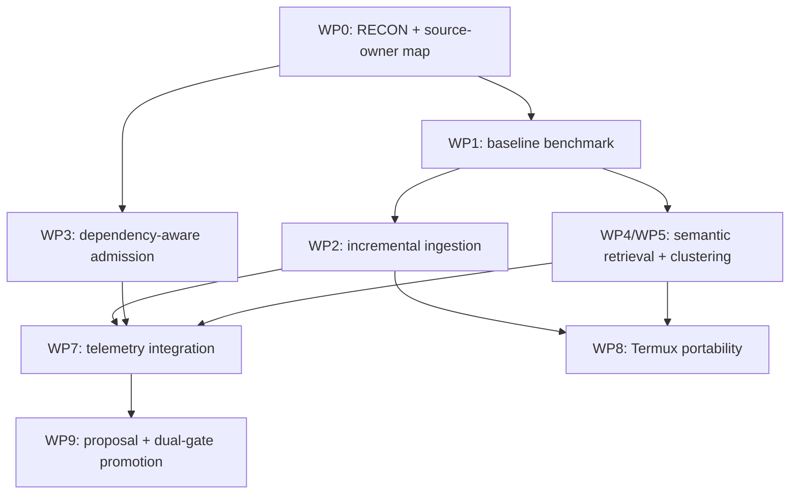

# Implementation Plan — Incremental Intelligence & Queue Efficiency

**Parent RFP:** [Incremental Intelligence RFP](../specs/2026-11-15-incremental-intelligence-queue-integration-rfp.md)  
**Status:** staged plan; implementation slices require source-owner revalidation  
**Target branch:** feature branch; no production dispatch changes in this plan

## Operating contract

Follow the repository-native loop:

`RECON → PLAN/MEASURE → ACT → COMMIT → WAIT → WATCH → VALIDATE → RE-FETCH → COMPARE → CLASSIFY → RECORD → REPEAT`

The work is parallelized by independent ownership boundaries. Parallel lanes may produce reviewable artifacts concurrently; only one integration lane changes a given canonical schema or file at a time.

## Parallel workstreams

### Lane A — event/incremental ingestion

- Re-fetch CEEL event schema, adapter contract, current workflow handlers and source-specific cursor/checkpoint implementation.
- Inventory redundant API calls and duplicate event paths.
- Add tests before optimizing.
- Implement conditional reads, entity hashes, bounded coalescing and safe cursor advancement only inside existing owning workflow/adapter.
- Preserve event references and partial coverage.
- Acceptance: full-scan parity on frozen fixture; duplicate delivery no-op; out-of-order source revision handled; crash/resume does not skip a page.

### Lane B — queue/dependency correctness

- Re-fetch `QUEUE-DEPENDENCY-TIERS.md`, `ops/quota/dispatch-tiers.json`, phase-engine contracts, queue producer/consumer and workflow dependencies.
- Distinguish authoring-time dependency errors from external Actions runner wait.
- Add static/synthetic tests that prevent follower workflow creation before prerequisite artifacts/gates.
- Use existing task idempotency and receipts; do not create a new broker.
- Acceptance: dependency DAG is acyclic; no task claim before prerequisites; duplicate producers do not create duplicate work; resource/quota gates are honored.

### Lane C — semantic retrieval

- Build a sanitized, frozen benchmark corpus from approved graph nodes and metadata only.
- Baseline lexical SQLite FTS5/BM25 and exact cosine similarity.
- Compare FAISS flat, IVF/HNSW and e-means/MiniBatchKMeans only in research/CI lane initially.
- Report candidate precision@k, recall@k, ANN recall@k, cluster stability, update cost, CPU, peak RSS and index bytes.
- Emit candidates only; no verified graph mutations.
- Acceptance: exact reproducibility from manifest + model/index version; no source text leakage; index rebuild from canonical corpus.

### Lane D — analytics/observability

- Reuse ATES and existing metrics exporters.
- Add only missing counters/histograms through their owning schemas.
- Evaluate DuckDB/Parquet as derived snapshots, not replacement storage.
- Keep queue wait, execution time, effect verification and promotion separate.
- Acceptance: each metric links to run/attempt/SHA and source; missing values remain unknown, not zero.

### Lane E — Termux/Android portability

- Preserve Python stdlib + SQLite + JSONL fallback.
- Keep FAISS, Arrow and DuckDB optional and out of device-critical path until proven.
- Run resource sentinel before and after; measure peak RSS, storage, battery/thermal if available.
- Test offline behavior and interrupted operations.
- Acceptance: core reconciliation remains usable without network and without optional native libraries.

## Dependency order

| Sequence | Work | Parallelism |
|---|---|---|
| 0 | Source-owner and supersession recon | single |
| 1 | Frozen baseline + fixture creation | parallel metric definitions; one frozen artifact |
| 2 | Incremental and queue synthetic tests | independent lanes |
| 3 | Implement incremental adapters and dependency admission | parallel only across distinct owners/files |
| 4 | Semantic retrieval / clustering research | independent from runtime lanes |
| 5 | Integrate ATES and corpus references | serialized schema-owner review |
| 6 | ARM64/Termux portability and failure drills | parallel test matrix |
| 7 | Full reconciliation parity + dual gates | single integration lane |
| 8 | Proposal/Delphi review and promotion decision | human-governed |

## Commit discipline

- Commit each independently reviewable documentation, test or implementation slice.
- Do not commit generated model/index binaries, embeddings, caches, logs, or corpus dumps.
- Every implementation commit states its source SHA, test command and outcome in the PR/receipt.
- Avoid multiple writers on the same path; parallel lanes use separate files/branches and integrate by reviewed cherry-pick or PR.
- Do not push to default branch, merge, deploy, or change live routing from this plan.

## Required test matrix

| Case | Expected behavior |
|---|---|
| Same delivery repeated 10x | One canonical observation; duplicate count visible |
| Revision N+1 arrives before N | Preserve order/provenance; act on re-fetched current revision |
| Crash after page fetch, before durable write | Cursor unchanged; safe replay |
| Crash after durable write, before cursor advance | Idempotent replay; no duplicate |
| Rate limit / Retry-After | Bounded wait; cursor preserved |
| Malformed schema/signature | Fail closed; no dispatch |
| Missing page / incomplete history | Partial status; no global completion |
| Queue prerequisite incomplete | Not admitted / blocked |
| Worker lease expires | Existing queue semantics recover without duplicate effect |
| Embedding model changes | New index namespace; no cross-space nearest-neighbor comparisons |
| ANN index corrupt | Rebuild from canonical source |
| Disk pressure | Skip optional index work; preserve evidence |
| Candidate lacks direct evidence | Remains candidate |
| Full rebuild vs incremental | Same deterministic node/edge set for same frozen source state |

## Rollback

Feature flag off → stop incremental adapter/coalescing → use existing bounded reconciliation → rebuild derived index → compare canonical counts and hashes → record rollback receipt. Never delete evidence or silently rewind checkpoints.
