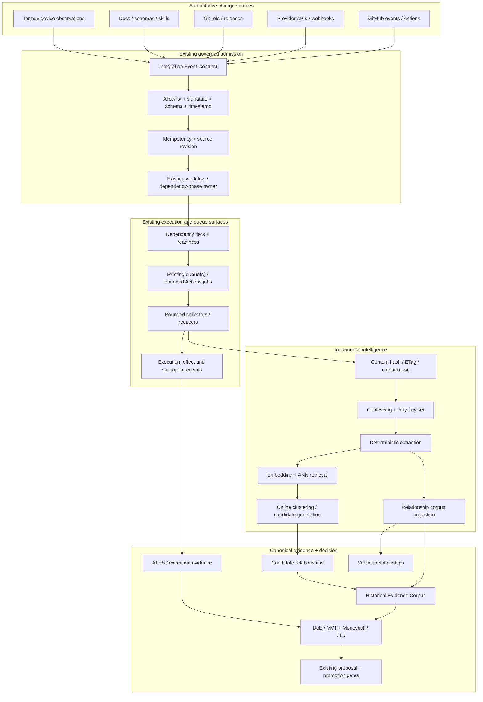
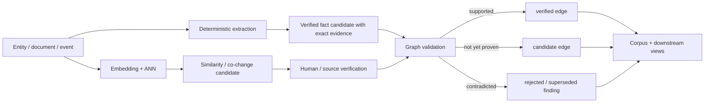

# RFP — Incremental Intelligence, Queue Efficiency & Semantic Discovery

**Date:** 2026-11-15  
**Status:** Architecture proposal; documentation implementation on feature branch  
**Target:** Android/Termux-first `termux-monorepo`  
**Architecture owner:** CEEL + Integration Intelligence + existing dependency-phase and evidence owners  
**Decision class:** additive integration; no new control plane

## 1. Executive summary

This RFP proposes an Incremental Intelligence Engine (IIE): a set of adapters, reducers, indexes and evaluation routines that make existing repository intelligence cheaper to update, more reliable under duplicate/out-of-order delivery, easier to navigate, and better at discovering useful relationships.

The system combines two ideas:

1. **Incremental event processing:** process only meaningful changes, coalesce bursts, reuse unchanged source material, and reconcile gaps.
2. **Probabilistic semantic discovery:** use embeddings, approximate-nearest-neighbor retrieval and online clustering to propose related entities, documents, issues, PRs, commits and capabilities.

The governing distinction is non-negotiable:

- deterministic evidence establishes verified facts;
- heuristics and ML produce candidates;
- human/repository-owned gates decide promotion;
- all observations remain attributable and replayable.

This is an integration program over CEEL, Integration Intelligence, the existing dependency-phase engine, ATES, the Historical Evidence Corpus, the Context Relationship Graph, existing queue contracts and Moneyball/3L0. It is **not** a new scheduler, central queue, telemetry database, CMDB, integration registry or graph authority.

## 2. Outcomes and non-goals

### Outcomes

- Lower API calls, repeated reads, duplicate processing, CPU and context consumption.
- Reduce event-to-evidence latency without sacrificing completeness.
- Preserve resumable historical backfill and source revision boundaries.
- Improve relationship discovery while preventing candidate edges from becoming authoritative silently.
- Make queue admission dependency-aware using existing queue/dependency contracts.
- Produce reproducible A/B/C benchmarks and durable receipts.
- Improve Android/Termux resource safety and offline tolerance.

### Non-goals

- Replace GitHub Actions scheduling or claim that GitHub exposes runner queue reprioritization.
- Add a new queue service, broker, scheduler, database, secret store or polling fleet.
- Replace JSONL evidence or the canonical relationship corpus.
- Adopt FAISS, DuckDB, Parquet, OpenTelemetry Collector, Kafka, NATS or another dependency before a measured need and portability review.
- Automatically merge, deploy, change provider routing, or promote candidate relationships.
- Treat speed, cluster membership, provider claims or workflow success as proof of correctness.

## 3. Current-state inventory and integration map

The repository already owns the key surfaces:

| Concern | Existing owner | IIE integration rule |
|---|---|---|
| External event envelope | `docs/integrations/schemas/integration-event.schema.json` | Extend only through its owner and adapter contract |
| Event admission and delivery semantics | `docs/integrations/CEEL-EVENT-CONTRACT.md` | Reuse allowlists, idempotency, timestamp/source validation and redaction |
| Continuous discovery/evolution | CEEL spec, DoE, proposal lifecycle | IIE is a capability lane, not a competing controller |
| Queue/device execution | P1 Device Pull Queue, existing queue-v3 and dispatch paths | Reuse task/receipt contracts; do not merge distinct queues into one |
| Dependency order | `ops/quota/dispatch-tiers.json`, dependency-phase engine, `QUEUE-DEPENDENCY-TIERS.md` | Enforce readiness at authoring/admission time; do not promise runner reprioritization |
| Relationship evidence | `workspace/llm_map/context_relationships/` | Preserve node/edge/manifest/checkpoint formats and verified/candidate distinction |
| Historical backfill | `context-relationship-backfill.yml` and corpus contracts | Keep page-bounded, resumable, explicit coverage states |
| Agent telemetry | ATES / Agent Evidence Substrate / throughput event schema | Extend through owning schema; no shadow telemetry ledger |
| Comparative learning | DoE/MVT, Moneyball/3L0 | Feed frozen observations; never rewrite history |
| Integration catalog | `docs/integrations/registry.json` | Add capabilities only through registry lifecycle |

**Precondition:** each implementation slice must re-fetch these owners at its target SHA and check for newer superseding proposals before editing implementation.

### 3.1 Existing implementation assets discovered during RECON

The current graph implementation is already more advanced than a generic node/edge index. The project-local graph skill documents:

- Python/schema-owned graph compilation and query under `archwiz/context_relationships/`;
- optional Rust hot path under `archwiz/context_relationships/rust_accel/`, with a safe Python adapter and `CRG_RUST_ACCEL=auto|required` modes;
- canonical BLAKE3-256 fingerprints and normalized JSONL boundaries;
- an L1 current relationship corpus plus L2 immutable temporal snapshots, structural deltas and append-only lineage;
- existing query, temporal query, publisher, bounded reconciler and explicit page-backfill workflows;
- the Historical Corpus Explorer as a deterministic projection, not a source of truth.

The queue implementation also has meaningful prior work: `ops/quota/dispatch-tiers.json` uses `queue.dispatch-tiers/v2` with class-level `after` edges and declared chains; `scripts/ops/swarm_admission.py` evaluates admission and dependency readiness. The existing P1 device pull queue is a separate D1-backed task/receipt contract whose device poller and Actions producer phases have distinct implementation status. IIE must not conflate it with GitHub Actions scheduling or the swarm dispatch queue.

Therefore the first implementation task is not to invent these features. It is to **measure, reconcile and connect** their existing implementations. In particular:
- semantic candidate generation must plug into the current graph's candidate-edge path and schema;
- new graph analytics must consume L1/L2 and preserve temporal lineage;
- dependency-aware admission must extend the current v2 tiers and admission evaluator;
- incremental source processing must use the current publisher/reconciler/backfill split;
- no second Rust accelerator, temporal store, graph explorer, queue, or task receipt format is permitted.

## 4. System architecture

### 4.1 Logical architecture



### 4.2 Event lifecycle and queue semantics

```mermaid
sequenceDiagram
  participant S as Source
  participant A as Existing admission
  participant D as Dependency/readiness
  participant Q as Existing queue/job
  participant W as Worker
  participant E as Evidence owners
  S->>A: event + source revision
  A->>A: validate, redact, derive idempotency key
  A->>D: request bounded work
  D->>D: verify dependencies, ownership, SHA freshness
  alt blocked or dependency incomplete
    D-->>A: blocked / await prerequisite
  else admissible
    D->>Q: enqueue or dispatch through existing owner
    Q->>W: bounded task claim
    W->>W: fetch delta, hash, process, checkpoint
    W->>E: append observation + receipt
    E->>E: reconcile and classify evidence
  end
  Note over A,E: Duplicate delivery is a no-op; reconciliation never rewrites history.
```

### 4.3 Relationship evidence lifecycle



A similarity score is a retrieval/ranking signal, not an evidence grade. Candidate edges must include algorithm/version, input fingerprints, score, threshold, generated time and evidence references. Verified edges must cite direct source evidence and the exact source revision.

## 5. Processing model

### 5.1 Incremental ingestion

Use source-native event delivery where available. For sources without events, use bounded cursor-based reads. A periodic reconciliation is a gap-recovery mechanism, not the primary sensing mechanism.

For each entity:
- identify source + entity + immutable revision;
- reuse ETag/Last-Modified or content hash where supported;
- fetch changed records only;
- parse once and cache only non-sensitive deterministic artifacts;
- write append-only observations;
- advance cursor/checkpoint only after durable acknowledgement and successful coverage accounting;
- preserve partial/failed states and continuation tokens.

Never advance a checkpoint across failed pages, incomplete pagination, invalid payloads or unrecorded omissions.

### 5.2 Coalescing and deduplication

Coalesce repeated triggers by a bounded key such as `source:entity_id:source_revision:operation`. Keep the latest source revision while retaining a count and reference list of coalesced deliveries. Do not discard distinct source revisions that are needed for history.

- At-least-once delivery is assumed.
- Duplicate delivery is idempotent.
- Out-of-order events are retained but re-fetch current source state before acting.
- Work is bounded by existing workflow concurrency, device queue and quota controls.
- Retries use exponential backoff with jitter and honor Retry-After.
- Authentication, signature, permission, privacy and schema errors are terminal until corrected.
- Ambiguous writes require reconciliation before retry.
- Dead-letter state is an observable failure classification in the owning queue; do not add another broker just to implement it.

### 5.3 Queue optimization and dependency-aware admission

Queue optimization is performed at the point the repository controls: task creation, dependency admission, workflow fan-out, and worker claim eligibility.

1. Classify each task using existing dispatch tiers and dependency-phase state.
2. Refuse admission while required prerequisites are unresolved.
3. Avoid creating follower jobs before the source artifact or required gate exists.
4. Coalesce redundant requests before they consume scarce runner/device capacity.
5. Bound heavy work using current resource/quota observations and existing limits.
6. Keep critical validation/gates independent from noncritical collectors.
7. Record queued, admitted, started, completed, failed, cancelled, effect-verified and promoted as distinct states.

GitHub runner scheduling is externally controlled. Do not claim to reprioritize already queued Actions jobs. Measure queue wait and reduce avoidable job creation and authoring-time dependency inversions.

## 6. Semantic discovery: e-means, FAISS and alternatives

### 6.1 Proposed first use

Build an offline, opt-in prototype over sanitized metadata and approved document text to retrieve related:
- issues and PRs;
- commits and changed-file clusters;
- architecture specs, ADRs and schemas;
- skills, workflow definitions and capability opportunities;
- historical observations and known regressions.

Use embeddings to find candidate neighbors. Apply exact metadata filters (repository, date, source type, SHA, status, access class) before or after vector search. Use a reranker only when it adds measured precision.

### 6.2 Algorithms

| Technique | Role | Adoption posture |
|---|---|---|
| Exact cosine / brute-force | Baseline for small corpora | Required reference baseline |
| FAISS flat index | Exact vector search at moderate scale | Prototype first; simple, local, no external service |
| FAISS IVF / HNSW | Approximate search at larger scale | Only after recall/latency break-even is measured |
| e-means / mini-batch k-means | Fast incremental cluster refresh | Research treatment; compare against Lloyd and MiniBatchKMeans |
| MiniBatchKMeans | Established online-ish baseline | Benchmark comparator |
| HDBSCAN | Density clusters and outlier discovery | Offline analysis; not default streaming assignment |
| MinHash / SimHash | Near-duplicate text and change fingerprints | Cheap prefilter for duplicate detection |
| BM25 / SQLite FTS5 | Lexical retrieval | Keep as hybrid retrieval baseline |
| Reciprocal-rank fusion | Combine lexical/vector candidates | Candidate-ranking treatment |
| Cross-encoder reranker | Precision improvement on shortlists | Optional expensive second stage |

Do not assume e-means speedups transfer to this corpus, hardware, embedding model or cluster geometry. Benchmark exact recall, candidate precision, wall time, CPU, peak RSS, index size and update cost. Record algorithm, implementation, seed, dimensions, metric, parameters and input corpus fingerprint.

### 6.3 Incremental cluster maintenance

- Maintain stable cluster IDs independent of centroid array positions.
- Version the embedding model and preprocessing contract.
- Assign new items against current centroids/index; flag low-confidence and out-of-distribution items.
- Update cluster statistics from bounded batches.
- Detect empty/tiny clusters and drift; split/merge only in a versioned rebuild proposal.
- Preserve prior assignments and emit reassignment events instead of rewriting history.
- Schedule full reconciliation when drift, index corruption, model version change or a configured maintenance boundary requires it.
- Keep candidate edges distinct from verified graph edges.

## 7. Technology portfolio and selection gates

| Technology | Potential use | Benefit | Cost / risk | Decision gate |
|---|---|---|---|---|
| GitHub webhooks / Actions events | Primary sensing | Lower polling lag and redundant API calls | Delivery gaps, event validation | Reuse current CEEL event contract |
| ETag / conditional GET / cursors | Source read optimization | Avoid unchanged payload reads | Provider-specific support | Measure 304/hit rate and correctness |
| SQLite / FTS5 | Local Termux metadata + lexical search | Small footprint, offline, mature | Write contention, schema evolution | Preferred local baseline |
| DuckDB | Analytical joins over JSONL/Parquet | Fast batch analysis without service | Memory and package footprint | Optional workstation/CI analysis |
| Apache Arrow | In-memory columnar interchange | Efficient analytics boundary | More dependencies | Adopt only if cross-tool exchange warrants |
| Parquet | Compressed historical analytical snapshots | Lower storage and scan cost | Not ideal as canonical append log | Derived projection only |
| FAISS | Vector index | Local ANN and exact baselines | Native build/platform complexity | Linux/CI prototype; Android portability proof |
| e-means / mini-batch k-means | Cluster refresh | Potentially fewer full-data passes | New method; dataset sensitivity | Comparative experiment, not assumed winner |
| OpenTelemetry | Metrics/traces/log correlation | Standardized instrumentation | Collector complexity and sensitive attributes | Export existing measurements; no duplicate telemetry store |
| Prometheus textfile / existing metrics | Device/worker counters | Simple scrape integration | Cardinality discipline | Prefer for small local counters |
| NATS JetStream / Kafka / Redpanda | Durable high-volume stream | Replay, fan-out, consumer groups | Operational footprint and hosting | Explicitly deferred; prove current lanes inadequate first |
| Temporal | Long-running durable orchestration | Retries, timers, workflows | Service/runtime complexity | Research only; existing phase engine remains owner |
| Redis | Cache/short-lived coordination | Fast shared state | New stateful service | Not needed for first slices |
| Bloom filters | Probabilistic membership prefilter | Lower duplicate lookups | False positives | Optional at scale; never sole correctness check |
| Merkle trees / content-addressed storage | Corpus integrity and delta comparison | Efficient integrity proofs | Index/manifest maintenance | Prototype for large snapshots |
| Tree-sitter | Syntax-aware extraction | Language-aware structural facts | Parser/version management | Targeted source indexing |
| Semgrep / CodeQL | Static security/semantic signals | Structured source findings | Runtime/CI cost and license constraints | Use existing approved lanes |
| OpenSearch / Elasticsearch | Large-scale text/vector search | Rich retrieval | Heavy memory/ops | Not suitable as first Termux dependency |
| Apache Lucene | Embedded lexical/index primitives | Mature retrieval core | JVM dependency | Consider only if SQLite FTS5 insufficient |

### 7.1 Platform tiers

- **Termux/device core:** Python stdlib, SQLite, JSONL, SHA-256, bounded shell/Python jobs. Keep memory and storage budgets explicit.
- **CI/research lane:** DuckDB, Arrow, FAISS, e-means, Tree-sitter, richer embedding evaluation.
- **Optional remote scale lane:** only if data volume, concurrent consumers and replay requirements exceed current infrastructure; a broker or vector service requires a separate RFP.

## 8. Data contracts and evidence invariants

Do not create a parallel canonical schema. Proposed extensions must be reviewed by the owners of:
- Integration Event schema;
- Historical Corpus manifest/nodes/edges/checkpoint;
- ATES event and experiment schemas;
- queue task/receipt schemas;
- capability opportunity graph schema.

Required metadata for every derived observation:
- `observation_id`, `source_id`, `source_revision`, `event_time`, `observed_at`, `ingested_at`;
- `idempotency_key`, `run_id`, `run_attempt`, `head_sha`, `workflow/job/step` where applicable;
- `operation`, `status`, `coverage_state`, `cursor_before`, `cursor_after`;
- `input_fingerprint`, `algorithm_id/version`, `config_fingerprint`;
- `evidence_refs`, `confidence`, `attribution`;
- `resource_metrics` and `error_class` when measured.

Privacy: no credentials, tokens, raw prompts/completions, browser profiles, private session dumps or secret-shaped provider payloads. Use stable opaque identifiers and hashes where appropriate.

## 9. Performance model and SLOs

Establish a baseline before setting targets. Report p50/p95/p99 where sample size supports them.

| Metric | Definition |
|---|---|
| Event-to-evidence latency | source event time → durable observation |
| Queue wait | admitted/queued → worker started |
| Processing time | worker started → receipt |
| Incremental work ratio | changed entities processed / total eligible entities |
| API efficiency | requests per newly verified observation |
| Conditional hit ratio | 304/not-modified responses / conditional reads |
| Duplicate suppression | duplicate deliveries suppressed / deliveries |
| Reconciliation gap | missed or stale events discovered by reconciliation |
| Checkpoint integrity | checkpoints advanced only after complete durable coverage |
| Candidate precision@k | reviewed relevant candidates / top-k candidates |
| Verified-edge precision | verified edges supported by direct evidence |
| ANN recall@k | approximate neighbors overlapping exact baseline |
| Index maintenance cost | CPU, wall time, peak RSS, bytes, update throughput |
| Queue inversion count | dependent/follower work starting before prerequisites |
| Device pressure | peak RSS, free storage, battery/thermal state where available |

Initial acceptance goals are relative to a measured baseline, not fabricated absolute SLOs:
- zero duplicate canonical observations for repeated identical deliveries;
- zero checkpoint advancement on incomplete/failed collection;
- no candidate-to-verified promotion without direct evidence;
- no task admitted while required dependencies are incomplete;
- no secret or raw prompt material in emitted artifacts;
- correctness parity with full reconciliation on the same frozen corpus;
- demonstrate a statistically credible reduction in work or resource use before production promotion.

## 10. Security, failure and recovery

Threats include forged webhooks, replay, event poisoning, prompt injection in source content, malicious repository metadata, stale revisions, queue lease expiry, duplicate claims, poisoned embeddings, sensitive corpus leakage, index corruption and partial checkpoint writes.

Controls:
- signature and source allowlists;
- strict schema and payload bounds;
- immutable source revision binding;
- deterministic idempotency keys;
- bounded retries and explicit terminal error classes;
- atomic checkpoint/manifest update where supported;
- quarantine malformed records without losing raw secrets (store only safe error metadata);
- content sanitization and untrusted-data handling;
- index rebuild from canonical corpus;
- backup/restore and corruption detection;
- least privilege and no generic write token;
- human review for candidate verification and promotion.

Failure matrix:

| Failure | Required behavior |
|---|---|
| Duplicate event | Idempotent no-op; increment suppression metric |
| Out-of-order revision | Retain event; re-fetch latest authoritative source |
| API rate limit | Honor Retry-After; persist cursor; do not spin |
| Partial page failure | Preserve partial status; do not advance global checkpoint |
| Worker crash | Lease/retry through existing queue contract; task must be idempotent |
| Disk pressure | Stop nonessential indexing; retain source evidence and checkpoints |
| Index corruption | Rebuild derived index from canonical corpus |
| Embedding model change | New index namespace/version; no mixed-space comparisons |
| Candidate poisoning | Keep candidate status; require independent source evidence |
| Schema mismatch | Fail closed and route to owning schema maintainer |

## 11. Delivery work packages

| WP | Scope | Deliverable | Acceptance |
|---|---|---|---|
| WP0 | Architecture reconciliation | owner map + ADR + source inventory | no duplicated control plane |
| WP1 | Baseline instrumentation | reproducible A benchmark | exact SHA, cohort, metrics, run receipts |
| WP2 | Incremental ingestion | cursor/hash/ETag + coalescing through existing handlers | correctness parity, duplicate tests |
| WP3 | Queue dependency admission | dependency-aware producer/phase integration | zero known dependency inversions in synthetic tests |
| WP4 | Semantic retrieval prototype | lexical + exact-vector + FAISS ANN comparisons | recall/precision/resource report |
| WP5 | Online clustering experiment | e-means vs Lloyd vs MiniBatchKMeans | assignment quality + update cost |
| WP6 | Analytical projections | optional DuckDB/Parquet snapshots | same counts/joins as canonical JSONL |
| WP7 | Observability | ATES/metrics extensions through owning contracts | traceable task-to-effect lineage |
| WP8 | Termux portability | SQLite/stdlib fallback + device resource proof | ARM64/Android/Termux and offline tests |
| WP9 | Promotion | proposal/Delphi + dual gates | operator-approved evidence-backed release |

## 12. Acceptance and exit criteria

A work package is complete only when:
1. its canonical owner and source SHA are recorded;
2. implementation is isolated and reviewable;
3. tests include duplicate, out-of-order, interruption, resume, rate-limit, malformed input and partial failure cases;
4. baseline and treatment use the same frozen inputs;
5. no canonical history is deleted or silently rewritten;
6. exact-source evidence supports verified relationships;
7. resource impact is measured on target hardware or clearly marked unavailable;
8. dual gates pass and the operator promotion boundary is honored;
9. documentation, runbook, rollback and known limitations are updated.

## 13. Rollout and rollback

Roll out in shadow mode first: observe and compare without changing dispatch decisions. Next enable incremental reads for one low-risk source family. Then enable coalescing for idempotent tasks. Next add dependency admission checks to a test cohort. Finally enable semantic candidate generation without automatic graph writes.

Rollback disables the new adapter/feature flag, returns to the existing full/bounded reconciliation path, and rebuilds derived indexes from canonical evidence. Never roll back by deleting evidence or moving a checkpoint backward without an explicit recovery record.

## 14. Decision requested

Approve the architecture and WP0–WP2 design/benchmark work. Treat WP3–WP8 as separately gated implementation slices. Do not approve a new broker, scheduler, database, vector service, or production dispatch mutation under this RFP.

## 15. Source references

- `docs/superpowers/specs/2026-11-11-continuous-capability-evolution-lab.md`
- `docs/integrations/CEEL-EVENT-CONTRACT.md`
- `docs/integrations/ADAPTER-CONTRACT.md`
- `docs/ops/AGENT-TEAM-ORCHESTRATION.md`
- `docs/ops/corpus/README.md`
- `docs/ops/P1-PULL-QUEUE-SPEC.md`
- `docs/ops/QUEUE-DEPENDENCY-TIERS.md`
- `docs/ops/AGENT-THROUGHPUT-EVENT.schema.json`
- `.agents/skills/context-relationship-graph/SKILL.md`
- `ops/quota/dispatch-tiers.json`
- FAISS e-means research: https://github.com/facebookresearch/faiss/tree/main/contrib/e_means
- Fluent Bit tail watcher configuration: https://docs.fluentbit.io/manual/pipeline/inputs/tail
- GitHub API conditional requests and best practices: https://docs.github.com/en/rest/using-the-rest-api/best-practices-for-using-the-rest-api
