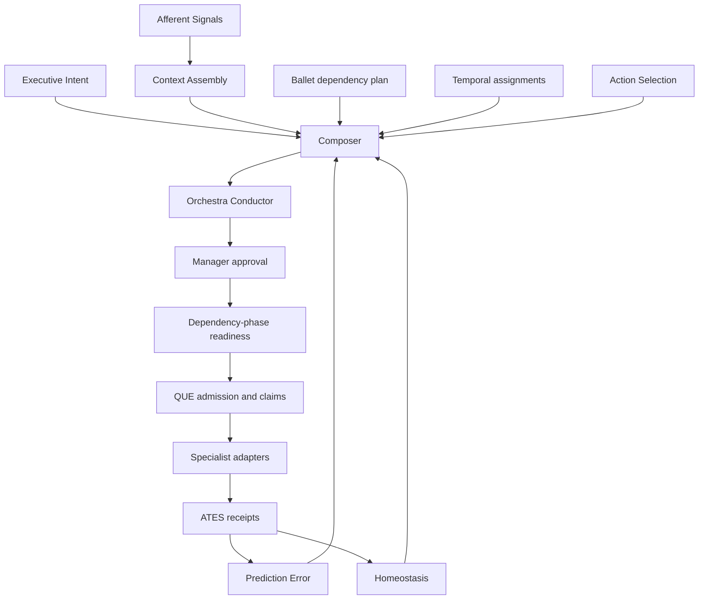

# Brain/CNS-Inspired Composer — Design Specification

**Status:** implementation design for PR #5939  
**Date:** 2026-11-27  
**Scope:** deterministic, evidence-aware composition over the existing Observatory, Ballet, Temporal Intelligence, Conductor, QUE, adapter, and ATES contracts.

## Intent and boundary

Build a modular coordination layer inspired by distributed nervous-system functions. The software accepts typed signals, assembles bounded context, normalizes a goal, proposes compatible actions, composes a deterministic score, and interprets timing feedback for future candidate policies.

Neuroscience language is an architectural analogy. It supplies memorable names for software responsibilities, with biological equivalence, medical validity, and brain simulation outside scope.

## Outcomes

- Establish an intent-to-score layer above existing planning and execution owners.
- Separate signal intake, context assembly, executive intent, action shortlisting, prediction error, and observation cadence into small testable modules.
- Produce a stable `brain.composer.score.v2` artifact with a content-derived `score_id`.
- Compile the score into the existing Orchestra Conductor cue-sheet contract.
- Preserve task identity, dependency metadata, timing windows, dependency barriers, wake conditions, and ATES evidence references through cue compilation.
- Make decisions replayable from normalized inputs and a versioned policy.
- Keep adaptation observational and candidate-only until explicit policy promotion.

## Approaches

1. **Monolithic Brain class:** fast initial implementation, with ingestion, intent, selection, timing, and composition coupled together.
2. **Small pure modules with a Composer facade — selected:** each module owns one transformation and returns data; Composer delegates cue generation to the existing Conductor. This matches the repository's Python Observatory modules and preserves control-plane ownership.
3. **Live neural/event runtime:** queues, timers, persistent memory, and dispatch adapters add lifecycle, concurrency, persistence, and operational authority beyond PR #5939. Defer until the pure contracts are proven.

## Module topology

| Module | CNS-inspired analogy | Responsibility | Output |
|---|---|---|---|
| `signals.py` | Afferent / sensory pathways | Validate, normalize, deduplicate, and sequence typed observations | ordered signal records |
| `context.py` | Hippocampal / working context | Assemble a bounded working set and retain evidence references | `brain.context.v1` |
| `executive.py` | Prefrontal executive function | Normalize goal, priority, constraints, and success criteria | `brain.intent.v1` |
| `action_selection.py` | Basal-ganglia action selection | Produce deterministic, write-disjoint action shortlist | ordered task IDs |
| `prediction.py` | Cerebellar prediction/error correction | Compare expected and actual duration | `brain.prediction-error.v1` |
| `homeostasis.py` | Autonomic / homeostatic regulation | Recommend the earliest observation wake boundary | `brain.homeostasis.wake.v1` |
| `composer.py` | Distributed integration | Compose normalized intent, context, existing plan, and cue sheet | `brain.composer.score.v2` |
| existing `conductor.py` | Motor planning / coordination | Compile plan plus assignment metadata into dispatch intent | `orchestra.cue-sheet.v1` |

The names are typed software concepts. The mapping remains explicitly analogical.

## Data contracts

- **Signal:** required `signal_id`, `source`, `kind`, `sequence`, `confidence`; non-empty identity/source/kind; non-negative integer sequence; confidence in [0, 1]; identical duplicate IDs collapse; conflicting duplicate IDs raise `ValueError`; order by `(sequence, signal_id)`.
- **Context:** `build_context(signals, episodes=(), max_items=64)` normalizes signals, retains the newest bounded slice, records truncation count, and collects unique episode evidence references. References remain explicit strings; resolution belongs to the evidence layer.
- **Intent:** `normalize_intent(intent)` requires a goal, accepts integer priority 0–5 (default 3), and sorts/deduplicates constraints and success criteria.
- **Action shortlist:** `select_actions(candidates, max_parallel=1)` sorts by descending integer priority and ascending task ID, then chooses a write-disjoint shortlist. QUE retains admission and claim authority; the dependency-phase engine retains readiness authority.
- **Prediction error:** `timing_error(expected_duration_ms, actual_duration_ms)` returns signed drift, classifies overrun/underrun/on-time, and emits `policy_action=observe_only`. Composer resolves the supplied evidence reference against the canonical ATES receipt and preserves source, run ID, cohort ID, evidence reference, and SHA-256 in feedback.
- **Wake recommendation:** `plan_wake(now_ms, event_deadline_ms=None, window_close_ms=None, max_wait_ms=60000)` returns the earliest future boundary for collector-owned timer scheduling.
- **Composer:** `compose_score(...)` joins normalized intent/context, ordered signal IDs, supplied Ballet plan, Conductor cue sheet, deterministic action shortlist, timing observations mapped through the canonical ATES receipt envelope and resolver (run ID, cohort ID, evidence reference, and SHA-256), optional homeostasis wake recommendation, authority map, candidate-only adaptation marker, and SHA-256 `score_id` over canonical JSON of preceding score fields.

Identical normalized inputs and policy version produce an identical score ID. Changes to action-selection policy inputs, including max_parallel, produce distinct score IDs even when the selected task IDs remain equal.

## Authority and data flow

```text
typed observations -> Afferent Signals -> Context Assembly
goal + constraints -> Executive Intent -> Action Shortlist
Ballet plan + Temporal assignment data -> COMPOSER
COMPOSER -> Orchestra Conductor cue sheet
cue sheet -> Manager / dependency-phase / QUE / adapters
adapters + collectors -> ATES canonical receipt
ATES -> Prediction Error + Homeostasis observations -> Composer feedback inputs
observations -> candidate policy evaluation (DoE / Observatory)
candidate -> explicit review + existing promotion gates
```

- Dependency-phase engine: canonical readiness and dependency barriers.
- Ballet: deterministic dependency-wave planning.
- Manager: routing and approval policy.
- QUE: admission, queue, claims, and priority windows.
- Specialist adapters: execution.
- ATES: canonical evidence receipts and provenance.
- Temporal Intelligence: phase, timing windows, collector cadence, wake semantics.
- Composer: intent/context/score composition only.
- Conductor: cue-sheet compilation and dispatch intent only.


## End-to-end score example

The following illustrates the data shape produced by the Composer. The score ID is a placeholder for the SHA-256 digest computed from canonical JSON.



```json
{
  "schema_version": "brain.composer.score.v2",
  "intent": {
    "schema_version": "brain.intent.v1",
    "goal": "validate release",
    "priority": 3,
    "constraints": ["evidence-required"],
    "success_criteria": ["tests-green"]
  },
  "context": {
    "schema_version": "brain.context.v1",
    "signals": [
      {
        "signal_id": "sig-ci-42",
        "source": "ci",
        "kind": "ready",
        "sequence": 42,
        "confidence": 1.0
      }
    ],
    "episode_ids": ["episode-12"],
    "evidence_refs": ["ates://receipt/12"],
    "truncated_signal_count": 0
  },
  "signal_ids": ["sig-ci-42"],
  "plan": {
    "waves": [["build"], ["tests"]],
    "task_count": 2
  },
  "action_shortlist": ["build", "tests"],
  "action_selection_policy": {
    "policy_version": "brain.action-selection.write-disjoint.v1",
    "max_parallel": 2
  },
  "timing_feedback": [
    {
      "task_id": "build",
      "source": "ATES",
      "run_id": "run-123",
      "cohort_id": "cohort-1",
      "evidence_ref": "ates://receipt/123",
      "sha256": "aaaaaaaaaaaaaaaaaaaaaaaaaaaaaaaaaaaaaaaaaaaaaaaaaaaaaaaaaaaaaaaa",
      "schema_version": "brain.prediction-error.v1",
      "expected_ms": 100,
      "actual_ms": 130,
      "drift_ms": 30,
      "status": "overrun",
      "policy_action": "observe_only"
    }
  ],
  "wake_recommendation": {
    "schema_version": "brain.homeostasis.wake.v1",
    "wake_at_ms": 150,
    "wake_in_ms": 50,
    "wake_reason": "window_close"
  },
  "cue_sheet": {
    "schema_version": "orchestra.cue-sheet.v1",
    "placement": "manager_policy",
    "policy_version": "orchestra-conductor.v1",
    "waves": [
      {
        "wave": 0,
        "tasks": [
          {
            "task_id": "build",
            "nominal_at": "2026-11-27T12:00:00Z",
            "opens_at": "2026-11-27T11:59:00Z",
            "closes_at": "2026-11-27T12:05:00Z",
            "expected_duration_ms": 100,
            "phase": "on_beat",
            "open_length_ms": 360000,
            "dependency_barriers": [],
            "evidence_refs": ["ates://receipt/build"],
            "depends_on": [],
            "wake_conditions": ["event", "window_close"]
          }
        ]
      },
      {
        "wave": 1,
        "tasks": [
          {
            "task_id": "tests",
            "nominal_at": "2026-11-27T12:01:00Z",
            "opens_at": "2026-11-27T12:00:00Z",
            "closes_at": "2026-11-27T12:06:00Z",
            "expected_duration_ms": 100,
            "phase": "on_beat",
            "open_length_ms": 360000,
            "dependency_barriers": ["build-ready"],
            "evidence_refs": ["ates://receipt/tests"],
            "depends_on": ["build"],
            "wake_conditions": ["event", "window_close"]
          }
        ]
      }
    ],
    "task_count": 2,
    "authority": "dispatch_intent_only",
    "dispatch_intent": true
  },
  "authority": {
    "composer": "intent_and_score_composition_only",
    "readiness": "dependency_phase_engine",
    "wave_planning": "ballet_coordinator",
    "admission_and_claims": "QUE",
    "execution": "specialist_adapters",
    "evidence": "ATES"
  },
  "adaptation": "candidate_only; validated_observations_and_explicit_policy_version_required",
  "score_id": "<content-derived-sha256>"
}
```

## Integration maturity

This PR delivers pure, composable library contracts and deterministic tests. The current repository workflows have no production caller for `compose_score`; scheduling it from a Manager/QUE workflow or collector event remains a follow-on integration item. The receipt resolver is a canonical boundary contract, and the ATES adapter implementation remains with its owning runtime surface.

## Runtime lifecycle

1. **Observe:** collectors and adapters publish typed signals with stable identities and sequence values.
2. **Remember:** Context Assembly creates a bounded working view and preserves episode evidence references.
3. **Decide:** Executive Intent normalizes the goal; Action Selection produces a deterministic candidate shortlist.
4. **Compose:** Composer joins the intent, context, Ballet plan, timing assignments, and feedback into a versioned score.
5. **Conduct:** Conductor emits a cue sheet. Manager, dependency-phase, and QUE apply their existing approval, readiness, admission, and claim contracts.
6. **Execute:** specialist adapters perform admitted work and publish lifecycle facts.
7. **Verify:** ATES validates canonical receipts. The Composer receipt adapter accepts canonical envelopes and resolver output; production workflow invocation remains a follow-on integration step.
8. **Learn:** DoE / Observatory evaluate candidate policy changes; existing promotion gates govern adoption.

## Safety and reliability invariants

1. Scores are declarative and deterministic for identical normalized inputs.
2. Signal identity collisions fail closed.
3. Context size is bounded; truncation is explicit.
4. Evidence references remain attached through composition.
5. QUE admission and readiness claims remain canonical after action shortlisting.
6. Timing drift remains an observation until an explicit candidate policy is reviewed.
7. Cue sheets preserve task IDs, dependencies, phase, nominal/open/close timestamps, expected duration, open length, dependency barriers, wake conditions, and evidence references.
8. Composer emits declarative score data; adapters consume approved cue sheets.
9. Score ID covers canonical content for audit and replay.
10. CNS terminology is descriptive analogy; production code and docs state this boundary.

## Failure behavior

| Input / event | Behavior |
|---|---|
| Missing signal field | Raise `ValueError` with missing field names |
| Conflicting duplicate signal ID | Reject the batch |
| Confidence outside [0, 1] | Reject the signal |
| Empty goal / priority outside 0–5 | Reject intent |
| Duplicate candidate task ID | Reject shortlist input |
| Write-path conflict | Select at most one conflicting candidate |
| Negative or non-finite timing | Reject timing observation |
| Past wake boundary | Ignore that boundary and select the next future boundary |
| Missing cue metadata | Conductor rejects score compilation |
| Missing task assignment | Conductor rejects score compilation |
| Changed evidence or policy input | Content-derived score ID changes |

## Acceptance

Unit tests cover normalization, duplicate conflicts, bounded context, intent validation, deterministic shortlist, write conflicts, timing classifications, earliest wake selection, integrated module wiring, canonical ATES receipt resolution, receipt-mismatch rejection, repeated-score stability, policy-sensitive score IDs, authority metadata, and cue metadata preservation. Existing focused Observatory tests and repository gates run on the exact pushed SHA. PR #5939 remains open until required checks and review disposition satisfy repository policy.

## Extension points

Future modules may add attention budgeting, salience ranking, working-memory decay, predictive confidence calibration, error-correction proposals, and multi-agent consensus summaries. Each addition requires a typed contract, owner, explicit authority boundary, and tests before integration. Incompatible score changes receive a new schema version.
